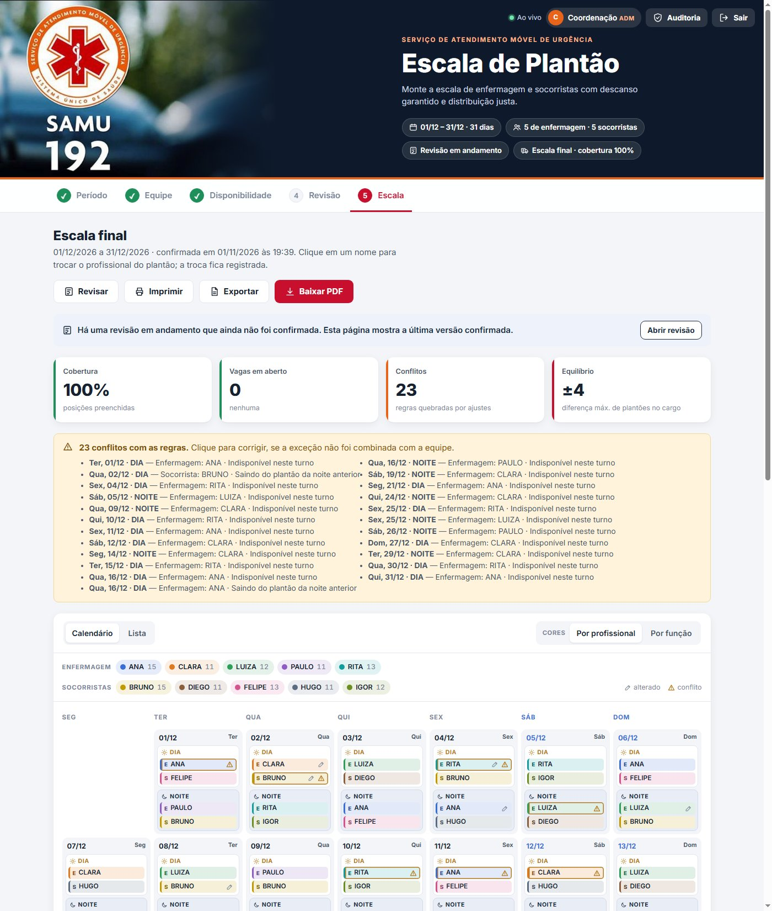
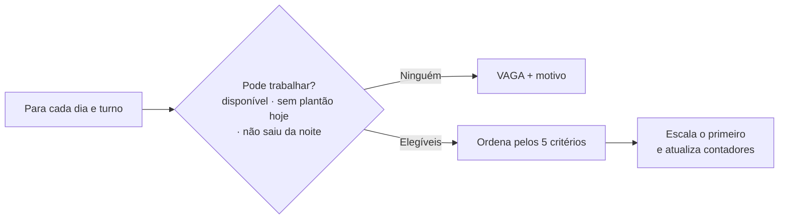
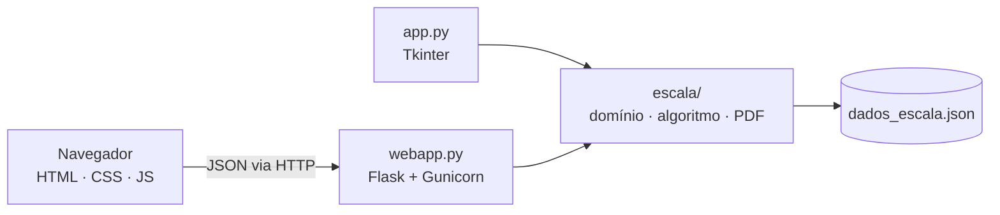

<div align="center">


# Escala de Plantão · SAMU 192

**Gerador automático de escalas para equipes de ambulância.**
Monta duplas de enfermeiro(a) e motorista para cada turno, respeita folgas, férias e descanso pós-noite, e divide os plantões de forma justa.


[Como rodar](#-como-rodar) · [Funcionalidades](#-funcionalidades) · [Algoritmo](#-como-o-algoritmo-decide) · [Arquitetura](#-arquitetura) · [Estudo de caso](docs/PORTFOLIO.md)

</div>

---



## 🚑 O problema

O SAMU 192 funciona 24 horas por dia. Cada dia tem dois turnos, **DIA** e **NOITE**, e cada turno precisa de uma equipe completa na viatura: **um(a) enfermeiro(a) e um(a) motorista**. Num mês de 31 dias são 124 posições a preencher.

Montar essa escala à mão significa cruzar a disponibilidade de cada pessoa, turno a turno, sem deixar viatura descoberta, sem colocar ninguém para trabalhar exausto e dividindo noites e fins de semana de forma justa. Este projeto automatiza esse trabalho.

## ✨ Funcionalidades

| Etapa | O que faz |
|---|---|
| **1. Período** | Define o ciclo da escala, com atalhos como "Próximo mês" e um resumo de dias e turnos. |
| **2. Equipe** | Cadastro de enfermeiros(as) e motoristas, com validação, busca e um alerta quando a equipe é pequena demais para garantir descanso. |
| **3. Disponibilidade** | Calendário por pessoa com "pincel": **Indisponível**, **Preferencial** ou **Férias**. Clique ou arraste sobre os turnos; clique na data para o dia inteiro ou no dia da semana para todas as ocorrências. Salva sozinho. |
| **4. Escala** | Geração com um clique, indicadores de cobertura e equilíbrio, motivo de cada vaga, destaque dos turnos de um profissional, visão em calendário ou lista, exportação em PDF. |

<table>
  <tr>
    <td></td>
    <td></td>
  </tr>
  <tr>
    <td align="center"><sub>Cadastro da equipe</sub></td>
    <td align="center"><sub>Disponibilidade com pincel</sub></td>
  </tr>
</table>

## 🚀 Como rodar

### Com Docker (recomendado)

Com o [Docker Desktop](https://www.docker.com/products/docker-desktop/) instalado:

- **Windows:** dois cliques em `iniciar.bat` (para desligar, `parar.bat`)
- **macOS / Linux:** `./iniciar.sh`

Ou pelo terminal:

```bash
git clone https://github.com/CarlosAlvesSantosJr/escalas-de-plantao.git
cd escalas-de-plantao
docker compose up -d --build
```

Abra **http://localhost:8080**. Os dados ficam na pasta `./dados`; para fazer backup, basta copiá-la.

> Guia passo a passo para quem não é da área de tecnologia: [docs/INSTALACAO.md](docs/INSTALACAO.md)

### Sem Docker (desenvolvimento)

```bash
pip install -r requirements.txt

python webapp.py      # versão web em http://localhost:5000
python app.py         # versão desktop (Tkinter)
python -m pytest      # testes
```

## 🧠 Como o algoritmo decide

**Regras que nunca são violadas:**

1. **Disponibilidade:** quem está indisponível ou de férias num turno nunca é escalado nele.
2. **Um plantão por dia:** ninguém trabalha DIA e NOITE na mesma data.
3. **Descanso pós-noite:** quem sai do turno da NOITE não entra no DIA seguinte.

O gerador percorre o período turno a turno. Entre os profissionais elegíveis, escolhe quem tem o menor custo, comparando estes critérios em ordem:

| # | Critério | Por quê |
|---|---|---|
| 1 | **Olhar adiante** | Não escala quem é o único disponível num turno logo à frente, evitando vagas que um algoritmo guloso simples criaria. |
| 2 | **Ninguém esquecido** | Quem está há 7 dias sem plantão ganha prioridade, salvo se esteve de férias ou indisponível a semana toda. |
| 3 | **Carga equilibrada** | Vence quem tem menos plantões. O turno preferencial vale um plantão a menos: pesa, sem permitir que uma pessoa fique com todos os turnos. |
| 4 | **Noites e fins de semana** | Entre empatados, quem fez menos noites e menos fins de semana. |
| 5 | **Desempate estável** | Quem trabalhou há mais tempo e, por fim, ordem alfabética. Os mesmos dados sempre geram a mesma escala. |

Turnos que não podem ser preenchidos aparecem como **vaga, com o motivo** (por exemplo, "Todos os motoristas indisponíveis ou de férias").



**Resultado com dados reais** (5 enfermeiros e 5 motoristas, outubro de 2026, dados anonimizados): 100% das 124 posições preenchidas, e a diferença máxima de plantões entre enfermeiros caiu de **5 para 3** em relação ao algoritmo original.

## 🏗️ Arquitetura

Um núcleo de domínio puro e testável, usado pelas duas interfaces.



```
escala/
├── dominio.py         Modelos (Funcionario, Periodo, Plantao) e enums (Cargo, Turno, Status)
├── algoritmo.py       Geração da escala, sem I/O
├── repositorio.py     Persistência JSON com escrita atômica (lê o formato antigo)
└── relatorio_pdf.py   Exportação em PDF
static/                Frontend web (sem framework, sem build)
tests/                 Testes das regras e da API
docs/                  Estudo de caso, fluxogramas e guia de instalação
webapp.py              API REST Flask
app.py                 Versão desktop
Dockerfile · docker-compose.yml · iniciar.bat · iniciar.sh · parar.bat
```

<details>
<summary><b>Rotas da API</b></summary>

| Método | Rota | Função |
|---|---|---|
| `GET` | `/api/estado` | Período e equipe |
| `PUT` | `/api/periodo` | Define o período (até 92 dias) |
| `POST` | `/api/funcionarios` | Cadastra profissional |
| `PUT` / `DELETE` | `/api/funcionarios/<id>` | Edita ou remove |
| `PATCH` | `/api/funcionarios/<id>/disponibilidade` | Altera disponibilidade em lote |
| `POST` | `/api/escala` | Gera a escala, com estatísticas e vagas |
| `GET` | `/api/escala.pdf` | Baixa o PDF |
| `GET` | `/saude` | Healthcheck |

</details>

## 🛠️ Tecnologias

**Backend:** Python 3.12, Flask, Gunicorn, fpdf
**Frontend:** HTML, CSS e JavaScript puros (ES modules)
**Desktop:** Tkinter, tkcalendar
**Infra:** Docker, Docker Compose
**Qualidade:** pytest (21 testes de regras de negócio e API)

## 🗺️ Próximos passos

- [ ] Troca de plantão entre profissionais, com aprovação da coordenação
- [ ] Ajuste manual de um turno direto na escala, com validação das regras
- [ ] Login e várias bases do SAMU no mesmo sistema
- [ ] Envio da escala por WhatsApp ou e-mail

## 📄 Licença

Distribuído sob a licença MIT. Veja [LICENSE](LICENSE).

---

<div align="center">
Desenvolvido por <b>Carlos Alves Santos Jr</b> · <a href="docs/PORTFOLIO.md">Leia o estudo de caso completo</a>
</div>
