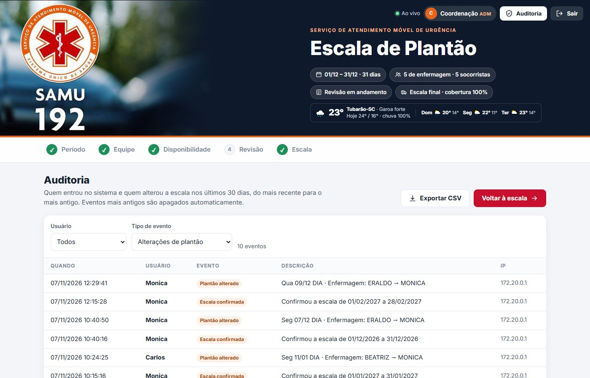
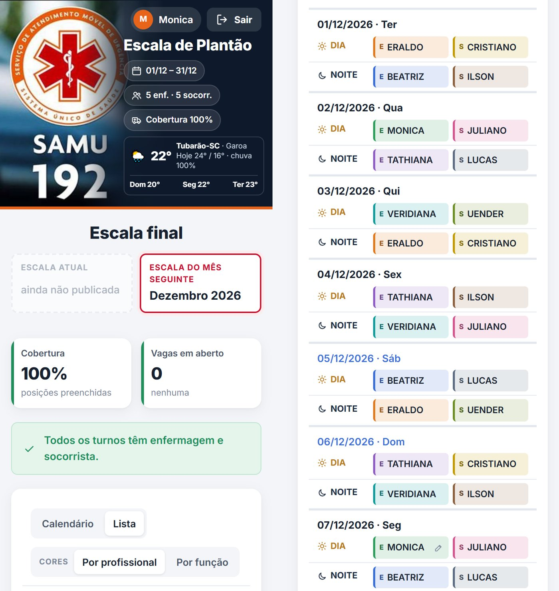
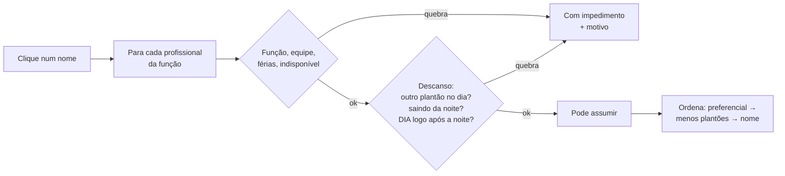
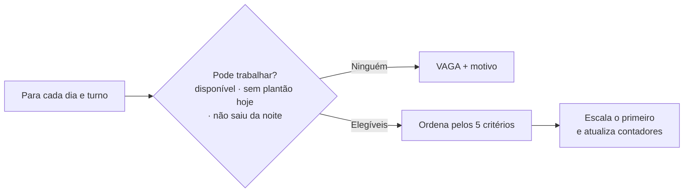
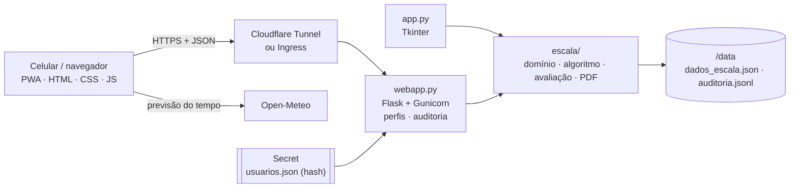
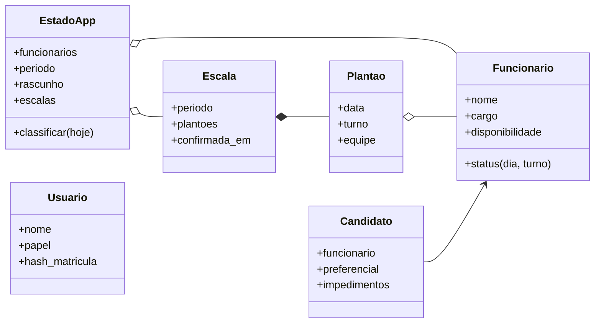

<div align="center">


# Escala de Plantão · SAMU 192

**Gerador automático de escalas para equipes de ambulância.**
Monta duplas de enfermagem e socorrista para cada turno, respeita folgas, férias e descanso pós-noite, e divide os plantões de forma justa. A equipe consulta e troca plantões pelo celular, como um app.


[Funcionalidades](#-funcionalidades) · [Perfis e acessos](#-acesso-perfis-e-auditoria) · [Troca de plantão](#-troca-de-plantão-quem-pode-assumir) · [Celular e app](#-no-celular-e-como-app) · [Algoritmo](#-como-o-algoritmo-decide) · [Arquitetura e API](#%EF%B8%8F-arquitetura) · [Kubernetes](k8s/README.md) · [Estudo de caso](docs/PORTFOLIO.md)

</div>

---


## 🚑 O problema

O SAMU 192 funciona 24 horas por dia. Cada dia tem dois turnos, **DIA** e **NOITE**, e cada turno precisa de uma equipe completa na viatura: **um(a) profissional de enfermagem e um(a) socorrista**. Num mês de 31 dias são 124 posições a preencher.

Montar essa escala à mão significa cruzar a disponibilidade de cada pessoa, turno a turno, sem deixar viatura descoberta, sem colocar ninguém para trabalhar exausto e dividindo noites e fins de semana de forma justa. Este projeto automatiza esse trabalho e deixa a palavra final com a coordenação: a proposta automática pode ser revisada e ajustada à mão antes de ser publicada. Depois de publicada, a própria equipe troca plantões entre si, com as regras de descanso checadas na hora e tudo registrado.

## ✨ Funcionalidades

| Etapa (ADM) | O que faz |
|---|---|
| **1. Período** | Define o ciclo da escala, com atalhos como "Próximo mês" e um resumo de dias e turnos. |
| **2. Equipe** | Cadastro de profissionais de enfermagem e socorristas, com validação, busca e um alerta quando a equipe é pequena demais para garantir descanso. |
| **3. Disponibilidade** | Calendário por pessoa com "pincel": **Indisponível**, **Preferencial** ou **Férias**. Clique ou arraste sobre os turnos; clique na data para o dia inteiro ou no dia da semana para todas as ocorrências. Salva sozinho. |
| **4. Revisão** | Proposta automática que pode ser ajustada à mão: clique num nome, veja quem pode assumir e o impedimento de quem não pode, troque ou deixe vago. Conflitos com as regras aparecem na hora, com desfazer (Ctrl+Z). Nada vai para a escala final sem confirmação. |
| **5. Escala** | Versão confirmada, com uma cor por profissional, legenda que destaca os plantões de cada pessoa, indicadores e visão em calendário ou lista. Abas **Mês atual** e **Mês seguinte** (o ADM vê também as anteriores e as futuras). PDF, impressão, exportação e importação. |

<table>
  <tr>
    <td></td>
    <td></td>
  </tr>
  <tr>
    <td align="center"><sub>2. Cadastro da equipe</sub></td>
    <td align="center"><sub>3. Disponibilidade com pincel</sub></td>
  </tr>
  <tr>
    <td></td>
    <td></td>
  </tr>
  <tr>
    <td align="center"><sub>4. Revisão: troca manual com o impedimento de cada pessoa</sub></td>
    <td align="center"><sub>5. PDF para a equipe: DIA e NOITE lado a lado</sub></td>
  </tr>
</table>

## 🔐 Acesso, perfis e auditoria

Cada pessoa entra com **nome e matrícula**. A matrícula não fica guardada em texto: o arquivo `usuarios.json` guarda só o hash (scrypt). Depois de 5 tentativas erradas em 15 minutos, o acesso daquele nome ou IP fica bloqueado por um tempo.

Há dois perfis. **As permissões são aplicadas no servidor**: as rotas da coordenação respondem 403 para o perfil Usuário, e os dados da coordenação nem são enviados a ele.

| Informação ou ação | ADM (coordenação) | Usuário (equipe) |
|---|:---:|:---:|
| Ver a escala do **mês atual** e do **mês seguinte** (calendário ou lista) | ✅ | ✅ |
| **Trocar o profissional de um plantão** (auditado) | ✅ | ✅ |
| Ver **quem pode assumir** e quem tem impedimento, com o motivo | ✅ | ✅ |
| Total de plantões de cada pessoa no editor de troca | ✅ | ❌ |
| Indicadores (cobertura, vagas, conflitos, equilíbrio) e avisos dos turnos | ✅ | ❌ |
| Conflitos com as regras e distribuição de plantões por profissional | ✅ | ❌ |
| Disponibilidade da equipe (férias, indisponível, preferencial) | ✅ | ❌ |
| Escalas anteriores e futuras | ✅ | ❌ |
| Período, equipe, disponibilidade, gerar proposta, Revisão e confirmar | ✅ | ❌ |
| Baixar PDF, imprimir, exportar e importar | ✅ | ❌ |
| Auditoria (com IPs) e exportação em CSV | ✅ | ❌ |
| Previsão do tempo, app instalável e atualização em tempo real | ✅ | ✅ |

<table>
  <tr>
    <td></td>
    <td></td>
  </tr>
  <tr>
    <td align="center"><sub>Login com nome e matrícula</sub></td>
    <td align="center"><sub>Visão do <b>Usuário</b>: só as abas Mês atual e Mês seguinte, a legenda e a escala</sub></td>
  </tr>
  <tr>
    <td colspan="2"></td>
  </tr>
  <tr>
    <td colspan="2" align="center"><sub>No celular, lado a lado: <b>ADM</b> (etapas, escala futura, botões, aviso de revisão em andamento) × <b>Usuário</b> (só as duas escalas)</sub></td>
  </tr>
  <tr>
    <td colspan="2"></td>
  </tr>
  <tr>
    <td colspan="2" align="center"><sub>Auditoria do ADM: quem entrou e quem trocou cada plantão, nos últimos 30 dias</sub></td>
  </tr>
</table>

- **Auditoria** (só ADM): entradas, saídas, tentativas de acesso falhas e cada troca de plantão, no formato "Qua 02/12 DIA · Enfermagem: MONICA → ERALDO", com usuário, data, hora e IP. Dá para filtrar por pessoa ou por tipo e exportar em CSV. Ficam guardados os **últimos 30 dias**; eventos mais antigos são apagados automaticamente (ajustável pela variável `ESCALA_AUDITORIA_DIAS`).
- **Tempo real:** cada tela consulta o servidor a cada 3 segundos e se atualiza sozinha quando alguém troca um plantão, com um aviso de quem trocou e um destaque piscando na posição. Uma aba que ficou mais de 2 minutos escondida é recarregada ao voltar.
- **Versão nova:** quando uma versão nova do sistema é publicada, as telas abertas recarregam sozinhas.
- **Uma pessoa por navegador:** se outra pessoa entrar no mesmo navegador, as abas abertas recarregam com o nome dela. Para testar dois usuários no mesmo computador, use uma janela anônima.

**Criar os usuários** (antes do primeiro acesso):

```bash
# lista.csv com uma pessoa por linha: NOME;MATRICULA;PAPEL  (PAPEL = ADMIN ou vazio)
python usuarios_cli.py gerar lista.csv dados/usuarios.json
rm lista.csv

python usuarios_cli.py adicionar dados/usuarios.json "Nome"     # inclui ou troca a matrícula de alguém
python usuarios_cli.py desativar dados/usuarios.json "Nome"     # tira o acesso
```

## 🔁 Troca de plantão: quem pode assumir

Esta é a parte que a equipe mais usa. Clicar num nome da escala abre o editor daquela posição (dia, turno e função). O sistema checa **cada profissional da função** contra as regras e mostra três grupos:

- **Podem assumir:** ninguém quebra regra nenhuma. Quem tem o turno como preferencial aparece com ⭐ e vem primeiro.
- **Com impedimento:** cada pessoa aparece com o motivo escrito. Dá para escalar mesmo assim, porque às vezes a exceção foi combinada, mas a posição passa a contar como **conflito**, que o ADM vê nos indicadores.
- **Deixar vago:** a posição fica em aberto.

<table>
  <tr>
    <td width="68%"></td>
    <td width="32%"></td>
  </tr>
  <tr>
    <td align="center"><sub>Qua 02/12, DIA, Enfermagem. <b>BEATRIZ</b> fez a NOITE de 01/12 e está saindo dela; <b>TATHIANA</b> já tem a NOITE de 02/12</sub></td>
    <td align="center"><sub>No celular: escala em cartões e o mesmo editor</sub></td>
  </tr>
</table>

**Os impedimentos checados** (`escala/avaliacao.py → impedimentos()`):

| Regra | Mensagem na tela |
|---|---|
| Função diferente da posição | "Cadastrado(a) em Socorrista" / "em Enfermagem" |
| Removido(a) da equipe | "Não faz mais parte da equipe" |
| Férias | "De férias" |
| Indisponível naquele turno | "Indisponível neste turno" |
| **Um plantão por dia** | "Já tem outro plantão neste dia" |
| **Descanso pós-noite** (fez a NOITE de ontem e pegaria o DIA de hoje) | "Saindo do plantão da noite anterior" |
| **Descanso pós-noite, olhando adiante** (pegaria esta NOITE e já tem o DIA de amanhã) | "Tem plantão de dia logo após esta noite" |



**Por trás:**
- **As mesmas regras em todo lugar.** O algoritmo que gera a escala, a Revisão do ADM e a troca feita pela equipe usam a mesma função. Não existe uma regra na tela e outra no servidor.
- **Avisa, não bloqueia.** A escolha é de quem conhece a situação, e o conflito fica visível para a coordenação.
- **Ninguém sobrescreve ninguém.** O editor guarda quem estava na posição quando foi aberto. Se outra pessoa trocou antes, o servidor recusa (409) e a tela se atualiza.
- **Tudo registrado.** Cada troca vai para a auditoria e aparece nas outras telas em até 3 segundos.
- **Privacidade.** O usuário vê só "Disponível"; o total de plantões de cada colega é informação do ADM.

O detalhamento, com diagramas de sequência, está em **[docs/ARQUITETURA.md](docs/ARQUITETURA.md#4-lógica-da-troca-de-plantão)**.

## 📅 Mês atual e mês seguinte

A equipe vê sempre duas abas, **Mês atual** e **Mês seguinte**, e pode trocar plantões em qualquer uma para se organizar com antecedência. O par **só avança quando o mês vira e o ADM confirma uma escala nova**:

| Situação | Mês atual | Mês seguinte |
|---|---|---|
| Novembro, com Dezembro e Janeiro confirmados | Dezembro | Janeiro |
| Virou janeiro, Fevereiro ainda não confirmado | Dezembro | Janeiro |
| Virou janeiro **e** o ADM confirmou Fevereiro | Janeiro | Fevereiro |

Escalas confirmadas antes da hora ficam como "futura" e as que saíram do par como "anterior"; essas só o ADM vê. Confirmar de novo um período substitui só aquela escala. Enquanto não houver uma segunda escala, a aba do mês seguinte aparece como "ainda não publicada".

## 📱 No celular e como app

- **Responsivo:** no celular a escala abre em lista, com um cartão por dia (DIA e NOITE, enfermagem e socorrista lado a lado), sem rolagem lateral. O topo deixa o símbolo do SAMU sempre visível à esquerda e põe título, período, equipe e clima numa coluna à direita.
- **Previsão do tempo:** o topo mostra o tempo de **Tubarão-SC** (agora, máxima e mínima, chance de chuva e os próximos 3 dias), pela API pública e gratuita da [Open-Meteo](https://open-meteo.com), sem chave. Atualiza a cada 30 minutos; se a API estiver fora do ar, o quadro some e o resto funciona normalmente.
- **App instalável (PWA):** "Adicionar à tela inicial" no Android ou iPhone, ou o ícone de instalar no Chrome/Edge do computador. Abre em tela cheia, com o ícone do SAMU. O service worker guarda só CSS, JS e imagens; a escala, o login e a auditoria vêm sempre do servidor, e sem internet aparece uma tela "Sem conexão". A instalação exige HTTPS (Kubernetes com túnel ou domínio) ou `localhost`.

## 📄 O PDF e a importação

Uma página por mês, com uma linha por dia: o turno **DIA** à esquerda e a **NOITE** à direita, cada um com **Enfermagem** e **Socorrista**. Cada profissional mantém a mesma cor da tela, e os fins de semana aparecem em destaque. O resumo de plantões por profissional fica só no sistema.

O PDF carrega os dados da escala embutidos: na Revisão ou na Escala, **Importar** aceita o PDF baixado do sistema ou o `.json` do botão **Exportar**. A escala abre na Revisão; quem não estiver na equipe é cadastrado automaticamente. É assim que se leva uma escala para outro computador.

## 🚀 Como rodar

```bash
git clone https://github.com/CarlosAlvesSantosJr/escalas-de-plantao.git
cd escalas-de-plantao
docker compose up -d --build        # http://localhost:8080 · dados em ./dados
```

No Windows, basta um duplo clique em `iniciar.bat` (e `parar.bat` para desligar). Veja o [guia de instalação](docs/INSTALACAO.md).

**Kubernetes:** os manifests estão em [`k8s/`](k8s/): 1 réplica, disco persistente, usuários num Secret, pod sem root com sistema de arquivos somente leitura. Três modos: no próprio PC com Cloudflare Tunnel, com endereço temporário (`https://…trycloudflare.com`) ou fixo no seu domínio (túnel nomeado, `k8s/tunel-fixo/`), ou na nuvem/VPS com HTTPS do Let's Encrypt. Passo a passo em **[k8s/README.md](k8s/README.md)**.

## 🧠 Como o algoritmo decide

**Regras que nunca são violadas:**

1. **Disponibilidade:** quem está indisponível ou de férias num turno nunca é escalado nele.
2. **Um plantão por dia:** ninguém trabalha DIA e NOITE na mesma data.
3. **Descanso pós-noite:** quem sai do turno da NOITE não entra no DIA seguinte.

O gerador percorre o período turno a turno. Entre os profissionais elegíveis, escolhe quem tem o menor custo, comparando estes critérios em ordem:

| # | Critério | Por quê |
|---|---|---|
| 1 | **Olhar adiante** | Não escala quem é o único disponível num turno logo à frente, evitando vagas que um algoritmo guloso simples criaria. |
| 2 | **Ninguém esquecido** | Quem está há 7 dias sem plantão ganha prioridade, salvo se esteve de férias ou indisponível a semana toda. |
| 3 | **Carga equilibrada** | Vence quem tem menos plantões. O turno preferencial vale um plantão a menos: pesa, sem permitir que uma pessoa fique com todos os turnos. |
| 4 | **Noites e fins de semana** | Entre empatados, quem fez menos noites e menos fins de semana. |
| 5 | **Desempate estável** | Quem trabalhou há mais tempo e, por fim, ordem alfabética. Os mesmos dados sempre geram a mesma escala. |

Turnos que não podem ser preenchidos aparecem como **vaga, com o motivo** (por exemplo, "Todos os socorristas indisponíveis ou de férias").



**Resultado com dados reais** (5 profissionais de enfermagem e 5 socorristas, outubro de 2026, dados anonimizados): 100% das 124 posições preenchidas, e a diferença máxima de plantões na enfermagem caiu de **5 para 3** em relação ao algoritmo original.

## 🏗️ Arquitetura

Um núcleo de domínio puro e testável (`escala/`), usado pela API web e pela versão desktop. O documento completo, com **UML de classes, diagramas de sequência, ciclo de vida da escala, matriz de permissões e segurança**, está em **[docs/ARQUITETURA.md](docs/ARQUITETURA.md)**.





```
escala/
├── dominio.py         Modelos (Funcionario, Periodo, Plantao, Escala) e enums (Cargo, Turno, Status)
├── algoritmo.py       Geração da escala, sem I/O
├── avaliacao.py       Regras: impedimentos, candidatos, vagas, conflitos e estatísticas
├── repositorio.py     Persistência JSON atômica e papéis das escalas (mês atual/seguinte)
├── usuarios.py        Login (matrícula em hash), limite de tentativas e auditoria (30 dias)
└── relatorio_pdf.py   PDF com DIA e NOITE lado a lado, com os dados embutidos para reimportar
static/                Frontend web (sem framework, sem build)
├── index.html · login.html · js/app.js · css/style.css
├── js/clima.js        Previsão do tempo (Open-Meteo)
├── manifest.webmanifest · sw.js · offline.html · js/pwa.js   App instalável (PWA)
└── img/icon-*.png     Ícones do app
tests/                 48 testes: regras, API, perfis, mês atual/seguinte, auditoria e PWA
docs/                  Arquitetura, estudo de caso, guia de instalação e imagens
webapp.py              API REST Flask (login, permissões por perfil, auditoria)
usuarios_cli.py        Cria e mantém o arquivo de usuários
k8s/                   Manifests do Kubernetes e guia de implantação
app.py                 Versão desktop
Dockerfile · docker-compose.yml · iniciar.bat · iniciar.sh · parar.bat
```

<details>
<summary><b>Rotas da API</b> (perfil de acesso em cada uma)</summary>

| Método | Rota | Função | Perfil |
|---|---|---|---|
| `POST` | `/api/login` · `/api/logout` | Entra (nome + matrícula) ou sai | Público / todos |
| `GET` | `/api/eu` | Usuário logado e perfil | Todos |
| `GET` | `/api/versao` | Versão dos dados e última troca (para atualizar as telas) | Todos |
| `GET` | `/api/estado` | Período, equipe, rascunho e escalas visíveis com o papel de cada uma | Todos (filtrado) |
| `GET` | `/api/escala[?inicio=AAAA-MM-DD]` | Uma escala confirmada (sem `inicio`, a do mês atual) | Todos (filtrado) |
| `PATCH` | `/api/escala[?inicio=…]` | Troca profissionais, com `esperado` contra sobrescrita e auditoria | Todos |
| `GET` | `/api/escala/candidatos?data&turno&cargo` | Quem pode assumir e os impedimentos de cada um | Todos (ADM vê o total) |
| `POST` | `/api/escala` | Confirma o rascunho | ADM |
| `POST` | `/api/escala/editar` | Abre uma cópia da escala final para revisão | ADM |
| `POST` | `/api/escala/importar` | Importa `.json` ou PDF gerado pelo sistema | ADM |
| `GET` | `/api/escala.pdf` · `/api/escala.json` | Baixa a escala em PDF ou JSON | ADM |
| `PUT` | `/api/periodo` | Define o período (até 92 dias) | ADM |
| `POST` · `PUT` · `DELETE` | `/api/funcionarios[/<id>]` | Cadastro da equipe | ADM |
| `PATCH` | `/api/funcionarios/<id>/disponibilidade` | Disponibilidade em lote | ADM |
| `GET` · `POST` · `PATCH` · `DELETE` | `/api/rascunho` | Escala em revisão: consulta, gera, ajusta, descarta | ADM |
| `GET` | `/api/rascunho/candidatos` | Candidatos de uma posição da revisão | ADM |
| `GET` | `/api/auditoria` · `/api/auditoria.csv` | Eventos dos últimos 30 dias | ADM |
| `GET` | `/saude` · `/manifest.webmanifest` · `/sw.js` | Healthcheck e PWA | Público |

</details>

## 🛠️ Tecnologias

**Backend:** Python 3.12, Flask, Gunicorn, fpdf
**Frontend:** HTML, CSS e JavaScript puros (ES modules), PWA (manifest + service worker), previsão do tempo pela Open-Meteo
**Desktop:** Tkinter, tkcalendar
**Infra:** Docker, Docker Compose, Kubernetes (Kustomize, Cloudflare Tunnel ou Ingress + Let's Encrypt)
**Qualidade:** pytest (48 testes de regras de negócio, API, perfis, auditoria e PWA)
