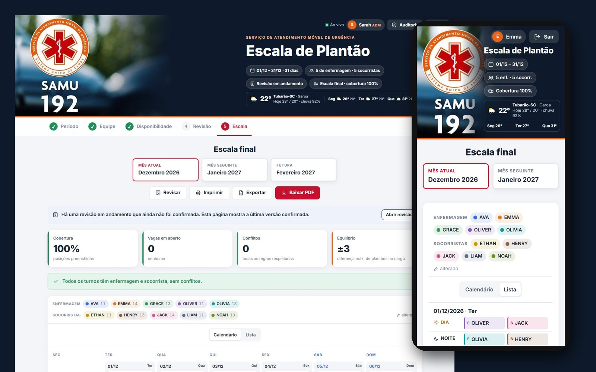
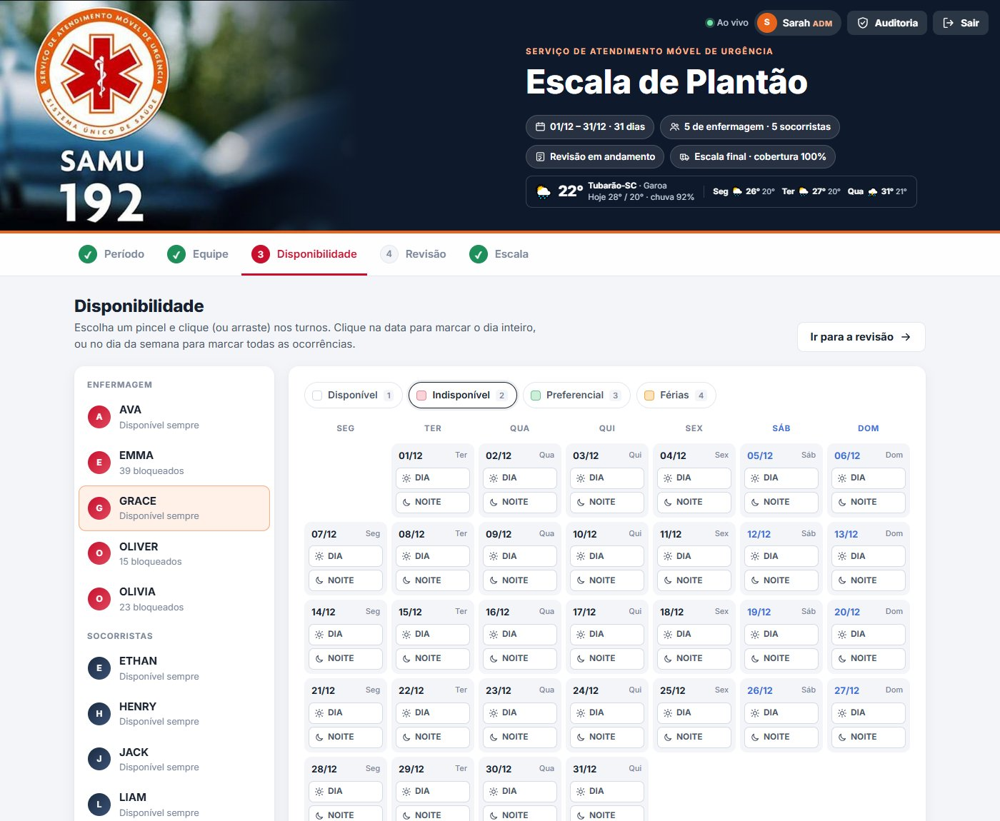
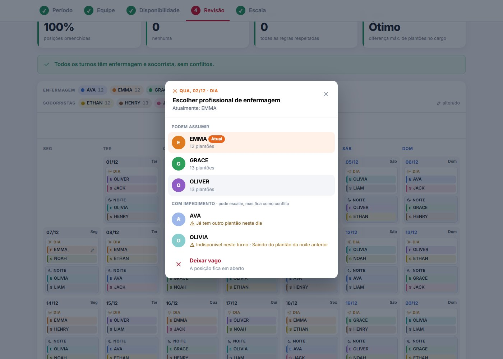
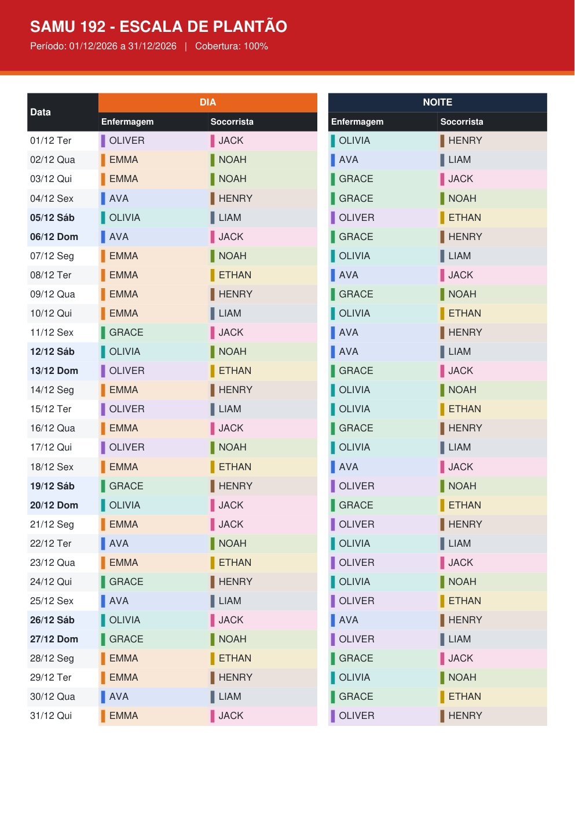
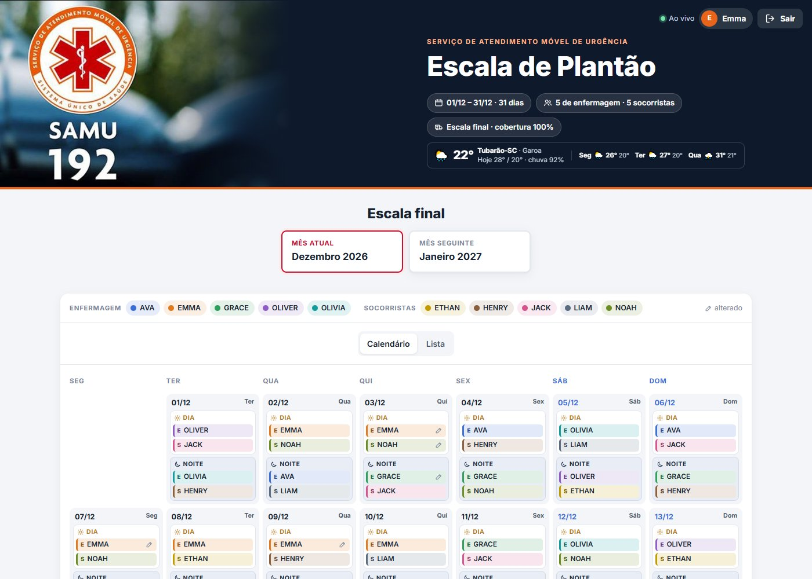
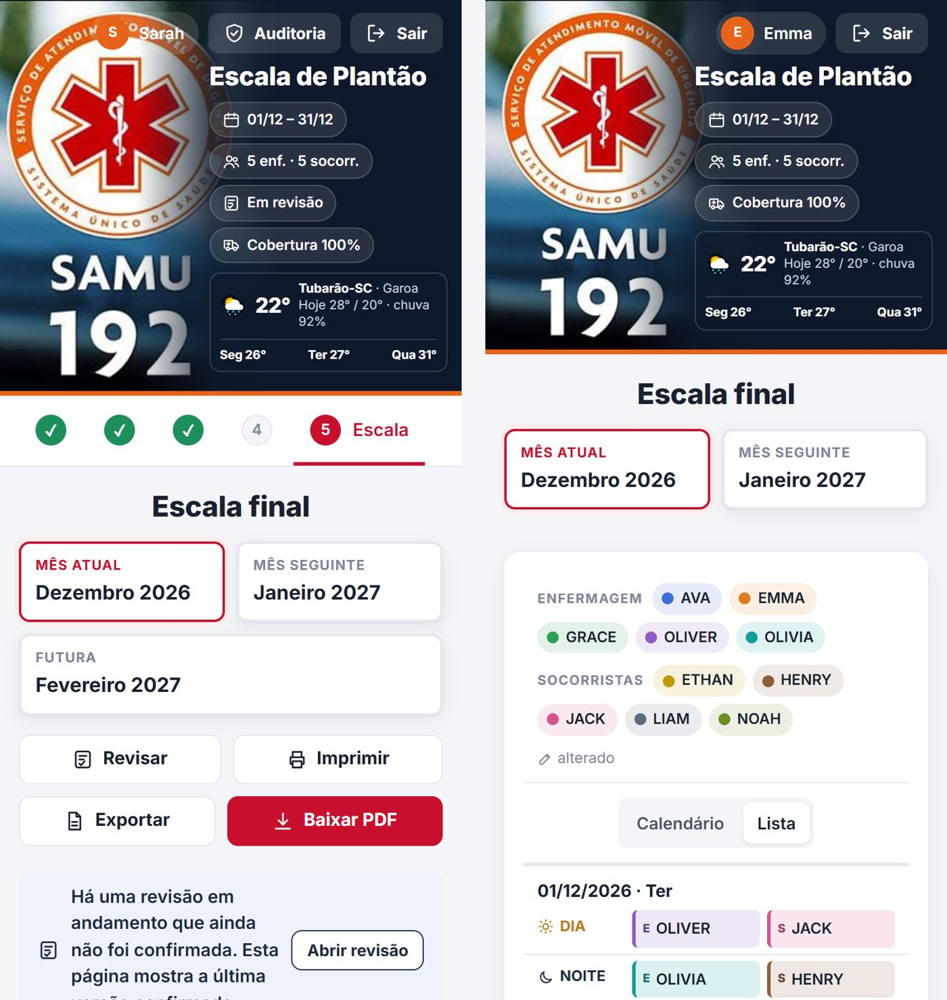
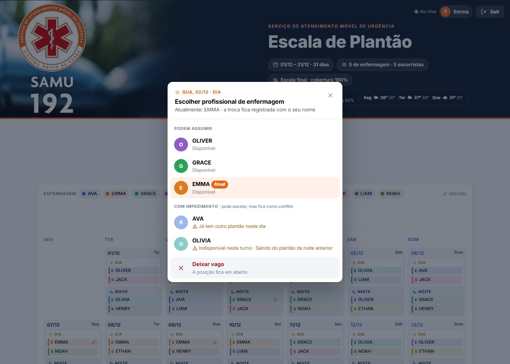
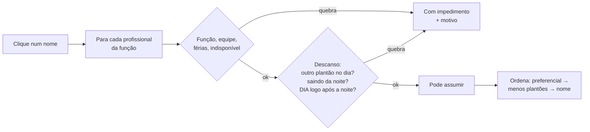
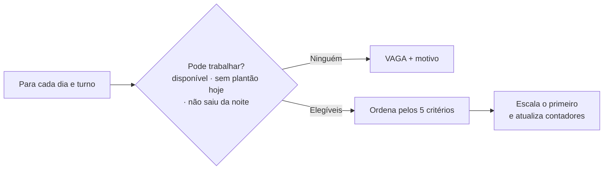
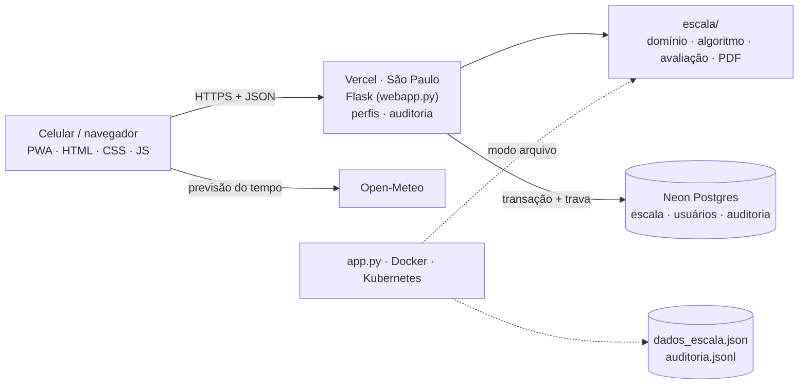

<div align="center">


# Escala de Plantão · SAMU 192

**Gerador automático de escalas de plantão para equipes de ambulância, em uso diário pela equipe do SAMU 192.**<br>
Monta as duplas de enfermagem e socorrista de cada turno, respeita folgas, férias e descanso pós-noite, e deixa a própria equipe trocar plantões pelo celular, com as regras checadas na hora.

### 🔗 [minhaescala192.vercel.app](https://minhaescala192.vercel.app)

[](https://minhaescala192.vercel.app)


[Em uso](#-em-uso-pela-equipe) · [Funcionalidades](#-funcionalidades) · [Perfis](#-acesso-perfis-e-auditoria) · [Troca de plantão](#-troca-de-plantão-quem-pode-assumir) · [Algoritmo](#-como-o-algoritmo-decide) · [Arquitetura](#%EF%B8%8F-arquitetura) · [Implantação](#-implantação) · [Estudo de caso](docs/PORTFOLIO.md)

</div>

---



<sub>Imagens com nomes fictícios. O acesso ao app é restrito à equipe (login com nome e matrícula).</sub>

## 🚑 Em uso pela equipe

Este não é um projeto de demonstração: **o sistema está em produção e é usado no dia a dia** pela coordenação e pela equipe de plantão do SAMU 192 de Tubarão-SC.

| Quem | Como usa |
|---|---|
| **Coordenação (ADM)** | Monta a escala do mês: define o período, marca férias e indisponibilidades, gera a proposta automática, revisa e publica. Acompanha pela auditoria quem trocou cada plantão. |
| **Equipe (enfermagem e socorristas)** | Abre o app no celular, vê a escala do mês atual e do seguinte e **troca plantões direto pelo app**: o sistema mostra quem pode assumir e quem não pode, e por quê. |

**O que mudou na rotina:**
- **Trocas de plantão sem papel, sem planilha e sem grupo de mensagens.** Quem precisa trocar abre o plantão no celular e vê na hora os colegas que podem assumir sem quebrar o descanso. A troca aparece para todos em segundos, com o nome de quem trocou.
- **Nenhuma troca quebra o descanso sem que se saiba.** As regras (um plantão por dia, descanso depois da noite, férias) são checadas a cada troca. Uma exceção combinada pode ser feita, mas fica marcada como conflito para a coordenação.
- **A escala do mês sai em minutos**, com as 124 posições de um mês de 31 dias preenchidas e os plantões, noites e fins de semana divididos de forma equilibrada.
- **Tudo registrado:** cada entrada no sistema e cada troca ficam na auditoria por 30 dias.

**Hoje:** 10 profissionais na escala (5 de enfermagem e 5 socorristas) e 11 usuários com acesso. O app roda na **Vercel**, com os dados num **Postgres da Neon**, os dois em São Paulo, e funciona 24 horas sem depender de nenhum computador ligado. A equipe instala no celular como app (PWA).

## 🩺 O problema

O SAMU 192 funciona 24 horas por dia. Cada dia tem dois turnos, **DIA** e **NOITE**, e cada turno precisa de uma equipe completa na viatura: **um(a) profissional de enfermagem e um(a) socorrista**. Num mês de 31 dias são 124 posições a preencher.

Montar essa escala à mão significa cruzar a disponibilidade de cada pessoa, turno a turno, sem deixar viatura descoberta, sem colocar ninguém para trabalhar exausto e dividindo noites e fins de semana de forma justa. E depois de pronta, a escala muda o mês todo: cada troca entre colegas precisava ser combinada, conferida contra as regras de descanso e repassada a todos.

Este projeto automatiza a montagem e leva as trocas para o celular. A palavra final continua com a coordenação: a proposta automática pode ser revisada e ajustada à mão antes de ser publicada.

## ✨ Funcionalidades

| Etapa (ADM) | O que faz |
|---|---|
| **1. Período** | Define o ciclo da escala, com atalhos como "Próximo mês" e um resumo de dias e turnos. |
| **2. Equipe** | Cadastro de profissionais de enfermagem e socorristas, com validação, busca e um alerta quando a equipe é pequena demais para garantir descanso. |
| **3. Disponibilidade** | Calendário por pessoa com "pincel": **Indisponível**, **Preferencial** ou **Férias**. Clique ou arraste sobre os turnos; clique na data para o dia inteiro ou no dia da semana para todas as ocorrências. Salva sozinho. |
| **4. Revisão** | Proposta automática que pode ser ajustada à mão: clique num nome, veja quem pode assumir e o impedimento de quem não pode, troque ou deixe vago. Conflitos aparecem na hora, com desfazer (Ctrl+Z). Nada vai para a escala final sem confirmação. |
| **5. Escala** | Versão publicada, com uma cor por profissional, legenda que destaca os plantões de cada pessoa, indicadores e visão em calendário ou lista. Abas **Mês atual** e **Mês seguinte**. PDF, impressão, exportação e importação. |

<table>
  <tr>
    <td></td>
    <td></td>
  </tr>
  <tr>
    <td align="center"><sub>2. Cadastro da equipe</sub></td>
    <td align="center"><sub>3. Disponibilidade com pincel</sub></td>
  </tr>
  <tr>
    <td></td>
    <td></td>
  </tr>
  <tr>
    <td align="center"><sub>4. Revisão: ajuste manual com o impedimento de cada pessoa</sub></td>
    <td align="center"><sub>5. PDF para a equipe: DIA e NOITE lado a lado</sub></td>
  </tr>
</table>

## 🔐 Acesso, perfis e auditoria

Cada pessoa entra com **nome e matrícula**. A matrícula não fica guardada em texto, só o hash (scrypt). Depois de 5 tentativas erradas em 15 minutos, o acesso daquele nome ou IP fica bloqueado por um tempo.

Há dois perfis. **As permissões são aplicadas no servidor**: as rotas da coordenação respondem 403 para o perfil Usuário, e os dados da coordenação nem são enviados a ele.

| Informação ou ação | ADM (coordenação) | Usuário (equipe) |
|---|:---:|:---:|
| Ver a escala do **mês atual** e do **mês seguinte** (calendário ou lista) | ✅ | ✅ |
| **Trocar o profissional de um plantão** (auditado) | ✅ | ✅ |
| Ver **quem pode assumir** e quem tem impedimento, com o motivo | ✅ | ✅ |
| Total de plantões de cada pessoa no editor de troca | ✅ | ❌ |
| Indicadores (cobertura, vagas, conflitos, equilíbrio) e avisos dos turnos | ✅ | ❌ |
| Conflitos com as regras e distribuição de plantões por profissional | ✅ | ❌ |
| Disponibilidade da equipe (férias, indisponível, preferencial) | ✅ | ❌ |
| Escalas anteriores e futuras | ✅ | ❌ |
| Período, equipe, disponibilidade, gerar proposta, Revisão e publicar | ✅ | ❌ |
| Baixar PDF, imprimir, exportar e importar | ✅ | ❌ |
| Auditoria (com IPs) e exportação em CSV | ✅ | ❌ |
| Previsão do tempo, app instalável e atualização automática | ✅ | ✅ |

<table>
  <tr>
    <td></td>
    <td></td>
  </tr>
  <tr>
    <td align="center"><sub>Login com nome e matrícula</sub></td>
    <td align="center"><sub>Visão do <b>Usuário</b>: só as abas Mês atual e Mês seguinte, a legenda e a escala</sub></td>
  </tr>
  <tr>
    <td colspan="2"></td>
  </tr>
  <tr>
    <td colspan="2" align="center"><sub>No celular, lado a lado: <b>ADM</b> (etapas, escala futura, botões, aviso de revisão em andamento) × <b>Usuário</b> (só as duas escalas)</sub></td>
  </tr>
  <tr>
    <td colspan="2"></td>
  </tr>
  <tr>
    <td colspan="2" align="center"><sub>Auditoria do ADM: quem trocou cada plantão, quando e de quem para quem, nos últimos 30 dias</sub></td>
  </tr>
</table>

- **Auditoria** (só ADM): entradas, saídas, tentativas de acesso falhas e cada troca de plantão, no formato "Qua 02/12 DIA · Enfermagem: EMMA → OLIVER", com usuário, data, hora e IP. Dá para filtrar por pessoa ou por tipo e exportar em CSV. Ficam guardados os **últimos 30 dias**; eventos mais antigos são apagados automaticamente.
- **Atualização automática:** as telas abertas percebem quando alguém troca um plantão, se atualizam sozinhas e mostram quem trocou, com um destaque piscando na posição.
- **Versão nova:** quando uma versão nova do sistema é publicada, as telas abertas recarregam sozinhas.

## 🔁 Troca de plantão: quem pode assumir

Esta é a parte que a equipe mais usa. Clicar num nome da escala abre o editor daquela posição (dia, turno e função). O sistema checa **cada profissional da função** contra as regras e mostra três grupos:

- **Podem assumir:** ninguém quebra regra nenhuma. Quem tem o turno como preferencial aparece com ⭐ e vem primeiro.
- **Com impedimento:** cada pessoa aparece com o motivo escrito. Dá para escalar mesmo assim, porque às vezes a exceção foi combinada, mas a posição passa a contar como **conflito**, que o ADM vê nos indicadores.
- **Deixar vago:** a posição fica em aberto.

<table>
  <tr>
    <td width="68%"></td>
    <td width="32%"></td>
  </tr>
  <tr>
    <td align="center"><sub>Emma quer passar o <b>próprio</b> plantão de Qua 02/12, DIA. <b>OLIVER</b> e <b>GRACE</b> podem assumir; <b>AVA</b> já tem outro plantão no dia e <b>OLIVIA</b> está saindo da noite anterior</sub></td>
    <td align="center"><sub>No celular: escala em cartões e o mesmo editor</sub></td>
  </tr>
</table>

**Os impedimentos checados** (`escala/avaliacao.py → impedimentos()`):

| Regra | Mensagem na tela |
|---|---|
| Função diferente da posição | "Cadastrado(a) em Socorrista" / "em Enfermagem" |
| Removido(a) da equipe | "Não faz mais parte da equipe" |
| Férias | "De férias" |
| Indisponível naquele turno | "Indisponível neste turno" |
| **Um plantão por dia** | "Já tem outro plantão neste dia" |
| **Descanso pós-noite** (fez a NOITE de ontem e pegaria o DIA de hoje) | "Saindo do plantão da noite anterior" |
| **Descanso pós-noite, olhando adiante** (pegaria esta NOITE e já tem o DIA de amanhã) | "Tem plantão de dia logo após esta noite" |



**Por trás:**
- **As mesmas regras em todo lugar.** O algoritmo que gera a escala, a Revisão do ADM e a troca feita pela equipe usam a mesma função. Não existe uma regra na tela e outra no servidor.
- **Avisa, não bloqueia.** A escolha é de quem conhece a situação, e o conflito fica visível para a coordenação.
- **Ninguém sobrescreve ninguém.** O editor guarda quem estava na posição quando foi aberto. Se outra pessoa trocou antes, o servidor recusa (409) e a tela se atualiza. No banco, cada gravação roda numa transação com trava, então duas trocas ao mesmo tempo são atendidas uma de cada vez.
- **Tudo registrado.** Cada troca vai para a auditoria e aparece nas outras telas abertas.
- **Privacidade.** O usuário vê só "Disponível"; o total de plantões de cada colega é informação do ADM.

O detalhamento, com diagramas de sequência, está em **[docs/ARQUITETURA.md](docs/ARQUITETURA.md#4-lógica-da-troca-de-plantão)**.

## 📅 Mês atual e mês seguinte

A equipe vê sempre duas abas, **Mês atual** e **Mês seguinte**, e pode trocar plantões em qualquer uma para se organizar com antecedência. O par **só avança quando o mês vira e o ADM publica uma escala nova**:

| Situação | Mês atual | Mês seguinte |
|---|---|---|
| Novembro, com Dezembro e Janeiro publicados | Dezembro | Janeiro |
| Virou janeiro, Fevereiro ainda não publicado | Dezembro | Janeiro |
| Virou janeiro **e** o ADM publicou Fevereiro | Janeiro | Fevereiro |

Escalas publicadas antes da hora ficam como "futura" e as que saíram do par como "anterior"; essas só o ADM vê. A virada do mês segue o horário de São Paulo, mesmo com o servidor em UTC.

## 📱 No celular e como app

- **Responsivo:** no celular a escala abre em lista, com um cartão por dia (DIA e NOITE, enfermagem e socorrista lado a lado), sem rolagem lateral. O topo deixa o símbolo do SAMU sempre visível.
- **App instalável (PWA):** em [minhaescala192.vercel.app](https://minhaescala192.vercel.app), "Adicionar à tela inicial" no Android ou iPhone. Abre em tela cheia, com o ícone do SAMU. O service worker guarda só CSS, JS e imagens; a escala, o login e a auditoria vêm sempre do servidor, e sem internet aparece uma tela "Sem conexão".
- **Previsão do tempo:** o topo mostra o tempo de **Tubarão-SC** (agora, máxima e mínima, chance de chuva e os próximos 3 dias), pela API pública e gratuita da [Open-Meteo](https://open-meteo.com).

## 📄 O PDF e a importação

Uma página por mês, com uma linha por dia: o turno **DIA** à esquerda e a **NOITE** à direita, cada um com **Enfermagem** e **Socorrista**. Cada profissional mantém a mesma cor da tela, e os fins de semana aparecem em destaque.

O PDF carrega os dados da escala embutidos: **Importar** aceita o PDF baixado do sistema ou o `.json` do botão **Exportar**. É assim que se leva uma escala para outra instalação.

## 🧠 Como o algoritmo decide

**Regras que nunca são violadas:**

1. **Disponibilidade:** quem está indisponível ou de férias num turno nunca é escalado nele.
2. **Um plantão por dia:** ninguém trabalha DIA e NOITE na mesma data.
3. **Descanso pós-noite:** quem sai do turno da NOITE não entra no DIA seguinte.

O gerador percorre o período turno a turno. Entre os profissionais elegíveis, escolhe quem tem o menor custo, comparando estes critérios em ordem:

| # | Critério | Por quê |
|---|---|---|
| 1 | **Olhar adiante** | Não escala quem é o único disponível num turno logo à frente, evitando vagas que um algoritmo guloso simples criaria. |
| 2 | **Ninguém esquecido** | Quem está há 7 dias sem plantão ganha prioridade, salvo se esteve de férias ou indisponível a semana toda. |
| 3 | **Carga equilibrada** | Vence quem tem menos plantões. O turno preferencial vale um plantão a menos: pesa, sem permitir que uma pessoa fique com todos os turnos. |
| 4 | **Noites e fins de semana** | Entre empatados, quem fez menos noites e menos fins de semana. |
| 5 | **Desempate estável** | Quem trabalhou há mais tempo e, por fim, ordem alfabética. Os mesmos dados sempre geram a mesma escala. |

Turnos que não podem ser preenchidos aparecem como **vaga, com o motivo** (por exemplo, "Todos os socorristas indisponíveis ou de férias").



**Resultado com os dados da equipe** (5 profissionais de enfermagem e 5 socorristas, outubro de 2026): 100% das 124 posições preenchidas, e a diferença máxima de plantões na enfermagem caiu de **5 para 3** em relação ao algoritmo original.

## 🏗️ Arquitetura

Um núcleo de domínio puro e testável (`escala/`), que não sabe onde os dados ficam. Em produção os dados vão para o Postgres; no Docker, no Kubernetes e no app desktop, para arquivos JSON. O mesmo código escolhe o modo pela variável `DATABASE_URL`.



| Decisão | Por quê |
|---|---|
| **Vercel + Neon** em produção | Funciona 24 h sem um PC ligado e com endereço fixo (o app instalado nos celulares não quebra), sem custo para uma equipe deste tamanho. Os dois em São Paulo. |
| **A escala como um documento JSONB** | O domínio já é um agregado lido e gravado inteiro (poucos KB). O formato é o mesmo do arquivo, então migrar e fazer backup é um comando. |
| **Trava do Postgres em cada gravação** | Na Vercel, cada acesso pode cair numa cópia diferente do app; a trava garante que duas trocas simultâneas não se sobrescrevam. |
| **Regras num lugar só** (`avaliacao.py`) | O algoritmo, a Revisão e a troca da equipe usam a mesma função de impedimentos. |
| **Frontend sem framework e sem build** | HTML, CSS e JS puros: leve no celular, nada para compilar, cache controlado pela versão dos arquivos. |
| **Permissões no servidor** | O perfil Usuário não recebe dados da coordenação; não depende da tela esconder nada. |

O documento completo, com **UML de classes, diagramas de sequência, ciclo de vida da escala, matriz de permissões, persistência e segurança**, está em **[docs/ARQUITETURA.md](docs/ARQUITETURA.md)**.

```
escala/
├── dominio.py         Modelos (Funcionario, Periodo, Plantao, Escala) e enums (Cargo, Turno, Status)
├── algoritmo.py       Geração da escala, sem I/O
├── avaliacao.py       Regras: impedimentos, candidatos, vagas, conflitos e estatísticas
├── repositorio.py     Estado da app, papéis das escalas (mês atual/seguinte) e gravação em JSON
├── banco.py           As mesmas interfaces sobre o Postgres (escala, usuários, auditoria, login)
├── usuarios.py        Login (matrícula em hash), limite de tentativas e auditoria (30 dias)
├── relogio.py         Data e hora no fuso de São Paulo
└── relatorio_pdf.py   PDF com DIA e NOITE lado a lado, com os dados embutidos para reimportar
static/                Frontend web (sem framework, sem build) e PWA
tests/                 80 testes: regras, API, perfis, concorrência, Postgres, auditoria e PWA
docs/                  Arquitetura, estudo de caso, guias e imagens
webapp.py              API REST Flask (login, permissões por perfil, auditoria)
vercel_app.py          Entrada na Vercel · pyproject.toml · vercel.json · .vercelignore
banco_cli.py           Envia dados para o banco e baixa backups
usuarios_cli.py        Cria e mantém os usuários
k8s/                   Manifests do Kubernetes e guia de implantação
app.py                 Versão desktop (Tkinter)
Dockerfile · docker-compose.yml · iniciar.bat · iniciar.sh · parar.bat
```

<details>
<summary><b>Rotas da API</b> (perfil de acesso em cada uma)</summary>

| Método | Rota | Função | Perfil |
|---|---|---|---|
| `POST` | `/api/login` · `/api/logout` | Entra (nome + matrícula) ou sai | Público / todos |
| `GET` | `/api/eu` | Usuário logado e perfil | Todos |
| `GET` | `/api/versao` | Versão dos dados e última troca (para atualizar as telas) | Todos |
| `GET` | `/api/estado` | Período, equipe, rascunho e escalas visíveis com o papel de cada uma | Todos (filtrado) |
| `GET` | `/api/escala[?inicio=AAAA-MM-DD]` | Uma escala publicada (sem `inicio`, a do mês atual) | Todos (filtrado) |
| `PATCH` | `/api/escala[?inicio=…]` | Troca profissionais, com `esperado` contra sobrescrita e auditoria | Todos |
| `GET` | `/api/escala/candidatos?data&turno&cargo` | Quem pode assumir e os impedimentos de cada um | Todos (ADM vê o total) |
| `POST` | `/api/escala` | Publica o rascunho | ADM |
| `POST` | `/api/escala/editar` | Abre uma cópia da escala publicada para revisão | ADM |
| `POST` | `/api/escala/importar` | Importa `.json` ou PDF gerado pelo sistema | ADM |
| `GET` | `/api/escala.pdf` · `/api/escala.json` | Baixa a escala em PDF ou JSON | ADM |
| `PUT` | `/api/periodo` | Define o período (até 92 dias) | ADM |
| `POST` · `PUT` · `DELETE` | `/api/funcionarios[/<id>]` | Cadastro da equipe | ADM |
| `PATCH` | `/api/funcionarios/<id>/disponibilidade` | Disponibilidade em lote | ADM |
| `GET` · `POST` · `PATCH` · `DELETE` | `/api/rascunho` | Escala em revisão: consulta, gera, ajusta, descarta | ADM |
| `GET` | `/api/rascunho/candidatos` | Candidatos de uma posição da revisão | ADM |
| `GET` | `/api/auditoria` · `/api/auditoria.csv` | Eventos dos últimos 30 dias | ADM |
| `GET` | `/saude` · `/manifest.webmanifest` · `/sw.js` | Healthcheck e PWA | Público |

</details>

## 🚀 Implantação

| Modo | Endereço | Dados | Guia |
|---|---|---|---|
| **Produção: Vercel + Neon** | **[minhaescala192.vercel.app](https://minhaescala192.vercel.app)** | Postgres (Neon, São Paulo) | [docs/VERCEL.md](docs/VERCEL.md) |
| Kubernetes | Cloudflare Tunnel no próprio PC, ou nuvem com Ingress e Let's Encrypt | Disco persistente (PVC) | [k8s/README.md](k8s/README.md) |
| Docker Compose | `http://localhost:8080` | Pasta `dados/` | [docs/INSTALACAO.md](docs/INSTALACAO.md) |

**Rodar no seu computador:**

```bash
git clone https://github.com/CarlosAlvesSantosJr/escalas-de-plantao.git
cd escalas-de-plantao
docker compose up -d --build        # http://localhost:8080 · dados em ./dados
```

No Windows, basta um duplo clique em `iniciar.bat` (e `parar.bat` para desligar).

**Criar os usuários** (antes do primeiro acesso):

```bash
# lista.csv com uma pessoa por linha: NOME;MATRICULA;PAPEL  (PAPEL = ADMIN ou vazio)
python usuarios_cli.py gerar lista.csv dados/usuarios.json && rm lista.csv
python banco_cli.py enviar --usuarios dados/usuarios.json   # só na produção (Postgres)
```

**Backup da produção:** `python banco_cli.py baixar backups/AAAA-MM-DD` baixa a escala, os usuários e a auditoria nos mesmos arquivos que o modo Docker usa.

## 🧪 Testes

**80 testes** com pytest. A bateria inteira da API roda duas vezes: sobre arquivos e sobre um **Postgres real**. A rodada no Postgres testa também os casos que só existem na nuvem:
- duas cópias do app gravando ao mesmo tempo sem perder dados;
- o login feito numa cópia valendo na outra;
- o bloqueio de tentativas de login valendo para todas as cópias.

```bash
python -m pytest -q    # modo arquivo; com ESCALA_TESTE_BANCO=postgresql://… roda também sobre o Postgres
```

## 🛠️ Tecnologias

**Backend:** Python 3.12, Flask, psycopg 3, fpdf
**Banco:** PostgreSQL (Neon), com JSONB e travas transacionais
**Frontend:** HTML, CSS e JavaScript puros (ES modules), PWA (manifest + service worker), Open-Meteo
**Infra:** Vercel (produção), Docker, Docker Compose, Kubernetes (Kustomize, Cloudflare Tunnel ou Ingress + Let's Encrypt), Gunicorn
**Qualidade:** pytest (80 testes), com a bateria da API repetida sobre um Postgres real
**Desktop:** Tkinter

---

<div align="center">

Feito por **[Carlos Alves Santos Jr](https://github.com/CarlosAlvesSantosJr)** · Estudo de caso completo em **[docs/PORTFOLIO.md](docs/PORTFOLIO.md)**

</div>
