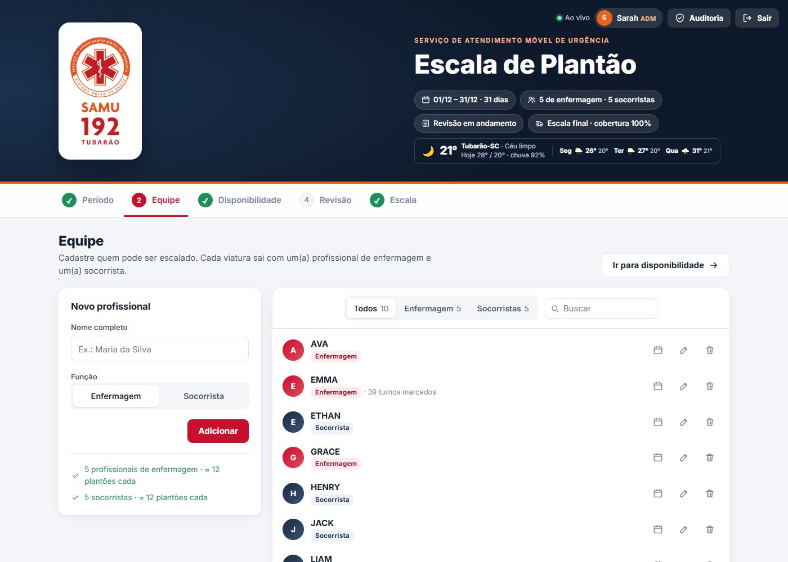
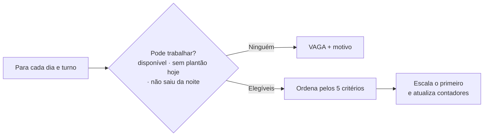
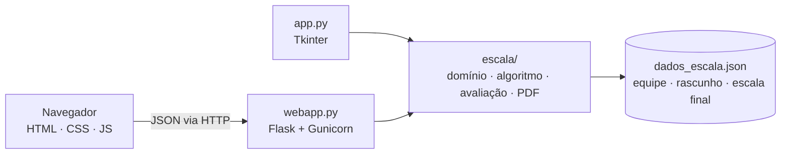

<div align="center">


# Escala de Plantão · SAMU 192

**Gerador automático de escalas para equipes de ambulância.**
Monta duplas de enfermagem e socorrista para cada turno, respeita folgas, férias e descanso pós-noite, e divide os plantões de forma justa.


[Kubernetes](k8s/README.md) · [Funcionalidades](#-funcionalidades) · [Acesso e perfis](#-acesso-perfis-e-auditoria) · [Algoritmo](#-como-o-algoritmo-decide) · [Arquitetura](#-arquitetura) · [Estudo de caso](docs/PORTFOLIO.md)

</div>

---


## 🚑 O problema

O SAMU 192 funciona 24 horas por dia. Cada dia tem dois turnos, **DIA** e **NOITE**, e cada turno precisa de uma equipe completa na viatura: **um(a) profissional de enfermagem e um(a) socorrista**. Num mês de 31 dias são 124 posições a preencher.

Montar essa escala à mão significa cruzar a disponibilidade de cada pessoa, turno a turno, sem deixar viatura descoberta, sem colocar ninguém para trabalhar exausto e dividindo noites e fins de semana de forma justa. Este projeto automatiza esse trabalho e deixa a palavra final com a coordenação: a proposta automática pode ser revisada e ajustada à mão antes de ser publicada.

## ✨ Funcionalidades

| Etapa | O que faz |
|---|---|
| **1. Período** | Define o ciclo da escala, com atalhos como "Próximo mês" e um resumo de dias e turnos. |
| **2. Equipe** | Cadastro de profissionais de enfermagem e socorristas, com validação, busca e um alerta quando a equipe é pequena demais para garantir descanso. |
| **3. Disponibilidade** | Calendário por pessoa com "pincel": **Indisponível**, **Preferencial** ou **Férias**. Clique ou arraste sobre os turnos; clique na data para o dia inteiro ou no dia da semana para todas as ocorrências. Salva sozinho. |
| **4. Revisão** | Proposta automática que pode ser ajustada à mão: clique num nome, veja quem está livre (e o impedimento de quem não está), troque ou deixe vago. Conflitos com as regras aparecem na hora, com desfazer (Ctrl+Z). Nada vai para a escala final sem confirmação. |
| **5. Escala** | Versão confirmada, com cores por profissional (ou por função), legenda que destaca os plantões de cada pessoa, indicadores e visão em calendário ou lista. Sai em PDF, imprime e exporta. Pode ser reaberta para edição. |

## 🔐 Acesso, perfis e auditoria

Cada pessoa entra com **nome e matrícula**. A matrícula não fica guardada em texto: o arquivo `usuarios.json` guarda só o hash (scrypt).

| Perfil | Pode |
|---|---|
| **ADM** | Tudo: equipe, período, disponibilidade, gerar e revisar propostas, confirmar, trocar plantões, PDF, importar e exportar, **conflitos com as regras**, **distribuição por profissional** e **auditoria** |
| **Usuário** | Ver a escala confirmada (cobertura e vagas) e **trocar o profissional de um plantão** |

Os conflitos com as regras, o equilíbrio, a contagem de plantões de cada pessoa e os IPs da auditoria são do ADM. O servidor nem envia esses dados para o perfil Usuário.

<table>
  <tr>
    <td></td>
    <td></td>
  </tr>
  <tr>
    <td align="center"><sub>Login com nome e matrícula</sub></td>
    <td align="center"><sub>Visão do usuário: troca de plantão, sem conflitos nem distribuição</sub></td>
  </tr>
  <tr>
    <td colspan="2"></td>
  </tr>
  <tr>
    <td colspan="2" align="center"><sub>Auditoria do ADM: quem entrou e quem trocou cada plantão</sub></td>
  </tr>
</table>

- **Tempo real:** cada tela consulta o servidor a cada 3 segundos e se atualiza sozinha quando alguém troca um plantão, com um aviso de quem trocou e um destaque piscando na posição. Isso vale também com a aba em segundo plano; uma aba que ficou mais de 2 minutos escondida ou "adormecida" pelo navegador é recarregada ao voltar. Se duas pessoas tentarem trocar a mesma posição ao mesmo tempo, a segunda recebe um aviso em vez de sobrescrever a troca da primeira.
- **Uma pessoa por navegador:** a sessão vale para o navegador inteiro. Se outra pessoa entrar no mesmo navegador, as abas abertas recarregam com o nome dela. Para testar dois usuários no mesmo computador, use uma janela anônima ou outro navegador para o segundo.
- **ADM com revisão aberta:** se um usuário trocar um plantão da escala confirmada enquanto o ADM revisa uma cópia, aparece um aviso na Revisão, porque confirmar a revisão substituiria essa troca.
- **Nomes das funções:** na tela, no PDF e na auditoria, as colunas são **Enfermagem** e **Socorrista**.
- **Auditoria** (só ADM): entradas, saídas, tentativas de acesso falhas e cada troca de plantão, no formato "Qua 02/12 DIA · Socorrista: DIEGO → BRUNO", com usuário, data, hora e IP. Dá para filtrar por pessoa ou por tipo e exportar em CSV.

**Criar os usuários** (antes do primeiro acesso):

```bash
# lista.csv com uma pessoa por linha: NOME;MATRICULA;PAPEL  (PAPEL = ADMIN ou vazio)
python usuarios_cli.py gerar lista.csv dados/usuarios.json
rm lista.csv

python usuarios_cli.py adicionar dados/usuarios.json "Nome"     # inclui ou troca a matrícula de alguém
python usuarios_cli.py desativar dados/usuarios.json "Nome"     # tira o acesso
```

### O PDF para a equipe

Uma página por mês, com uma linha por dia: o turno **DIA** à esquerda e a **NOITE** à direita, cada um com as colunas **Enfermagem** e **Socorrista**. Cada profissional mantém a mesma cor da tela, e os fins de semana aparecem em destaque. O resumo de plantões por profissional fica só no sistema, para a coordenação; não vai no PDF nem na impressão.

### Importar uma escala salva

Na Revisão ou na Escala, use **Importar** com o **PDF baixado do sistema** (ele carrega os dados da escala embutidos) ou com o arquivo `.json` do botão **Exportar**. A escala abre na Revisão para ser editada; o período passa a ser o dela e quem não estiver na equipe é cadastrado automaticamente. É assim também que se leva uma escala para outro computador. PDFs gerados antes desta versão não trazem os dados e não podem ser importados.

<table>
  <tr>
    <td></td>
    <td></td>
  </tr>
  <tr>
    <td align="center"><sub>Cadastro da equipe</sub></td>
    <td align="center"><sub>Disponibilidade com pincel</sub></td>
  </tr>
  <tr>
    <td></td>
    <td></td>
  </tr>
  <tr>
    <td align="center"><sub>Revisão: troca manual com impedimentos de cada pessoa</sub></td>
    <td align="center"><sub>PDF para a equipe: DIA e NOITE lado a lado</sub></td>
  </tr>
</table>

## ☸️ Kubernetes

Os manifests estão em [`k8s/`](k8s/): 1 réplica, disco persistente, usuários num Secret e pod sem root com sistema de arquivos somente leitura. Há dois modos: na nuvem ou numa VPS, com HTTPS do Let's Encrypt, ou no próprio PC com Cloudflare Tunnel. O passo a passo está em **[k8s/README.md](k8s/README.md)**.

## 🧠 Como o algoritmo decide

**Regras que nunca são violadas:**

1. **Disponibilidade:** quem está indisponível ou de férias num turno nunca é escalado nele.
2. **Um plantão por dia:** ninguém trabalha DIA e NOITE na mesma data.
3. **Descanso pós-noite:** quem sai do turno da NOITE não entra no DIA seguinte.

O gerador percorre o período turno a turno. Entre os profissionais elegíveis, escolhe quem tem o menor custo, comparando estes critérios em ordem:

| # | Critério | Por quê |
|---|---|---|
| 1 | **Olhar adiante** | Não escala quem é o único disponível num turno logo à frente, evitando vagas que um algoritmo guloso simples criaria. |
| 2 | **Ninguém esquecido** | Quem está há 7 dias sem plantão ganha prioridade, salvo se esteve de férias ou indisponível a semana toda. |
| 3 | **Carga equilibrada** | Vence quem tem menos plantões. O turno preferencial vale um plantão a menos: pesa, sem permitir que uma pessoa fique com todos os turnos. |
| 4 | **Noites e fins de semana** | Entre empatados, quem fez menos noites e menos fins de semana. |
| 5 | **Desempate estável** | Quem trabalhou há mais tempo e, por fim, ordem alfabética. Os mesmos dados sempre geram a mesma escala. |

Turnos que não podem ser preenchidos aparecem como **vaga, com o motivo** (por exemplo, "Todos os socorristas indisponíveis ou de férias").

**Na revisão manual, as mesmas regras continuam valendo.** A coordenação pode escalar alguém mesmo com impedimento, porque às vezes a exceção foi combinada com a equipe, mas a posição fica marcada como **conflito** e aparece nos indicadores até ser resolvida ou confirmada. A avaliação (`escala/avaliacao.py`) é a mesma para a escala gerada e para a editada à mão.



**Resultado com dados reais** (5 profissionais de enfermagem e 5 socorristas, outubro de 2026, dados anonimizados): 100% das 124 posições preenchidas, e a diferença máxima de plantões na enfermagem caiu de **5 para 3** em relação ao algoritmo original.

## 🏗️ Arquitetura

Um núcleo de domínio puro e testável, usado pelas duas interfaces.



```
escala/
├── dominio.py         Modelos (Funcionario, Periodo, Plantao) e enums (Cargo, Turno, Status)
├── algoritmo.py       Geração da escala, sem I/O
├── avaliacao.py       Estatísticas, vagas e conflitos de qualquer escala (gerada ou editada)
├── repositorio.py     Persistência JSON com escrita atômica (equipe, rascunho e escala final)
├── usuarios.py        Login (matrícula em hash), limite de tentativas e auditoria
└── relatorio_pdf.py   PDF com DIA e NOITE lado a lado, com os dados embutidos para reimportar
static/                Frontend web (sem framework, sem build)
tests/                 Testes das regras e da API
docs/                  Estudo de caso, fluxogramas e guia de instalação
webapp.py              API REST Flask (com login e permissões por perfil)
usuarios_cli.py        Cria e mantém o arquivo de usuários
k8s/                   Manifests do Kubernetes e guia de implantação
app.py                 Versão desktop
Dockerfile · docker-compose.yml · iniciar.bat · iniciar.sh · parar.bat
```

<details>
<summary><b>Rotas da API</b></summary>

| Método | Rota | Função |
|---|---|---|
| `POST` | `/api/login` · `/api/logout` | Entra (nome + matrícula) ou sai |
| `GET` | `/api/eu` | Usuário logado e perfil |
| `GET` | `/api/versao` | Versão dos dados e última troca de plantão (para atualizar as telas) |
| `GET` | `/api/estado` | Período, equipe, rascunho e escala final |
| `PUT` | `/api/periodo` | Define o período (até 92 dias) |
| `POST` | `/api/funcionarios` | Cadastra profissional |
| `PUT` / `DELETE` | `/api/funcionarios/<id>` | Edita ou remove |
| `PATCH` | `/api/funcionarios/<id>/disponibilidade` | Altera disponibilidade em lote |
| `GET` / `POST` / `DELETE` | `/api/rascunho` | Consulta, gera ou descarta a escala em revisão |
| `PATCH` | `/api/rascunho` | Altera posições em lote (`funcionario_id: null` = vago) |
| `GET` | `/api/rascunho/candidatos` | Quem pode ocupar uma posição e o que cada um quebraria |
| `PATCH` | `/api/escala` | Troca profissionais na escala confirmada (todos os perfis, com auditoria e `esperado` contra sobrescrita) |
| `GET` | `/api/escala/candidatos` | Candidatos para uma posição da escala confirmada |
| `GET` | `/api/auditoria` · `/api/auditoria.csv` | Eventos de acesso e alterações (ADM) |
| `GET` / `POST` | `/api/escala` | Consulta a escala final / confirma o rascunho |
| `POST` | `/api/escala/editar` | Abre uma cópia da escala final para revisão |
| `POST` | `/api/escala/importar` | Importa `.json` ou PDF gerado pelo sistema (multipart, campo `arquivo`) |
| `GET` | `/api/escala.pdf` · `/api/escala.json` | Baixa a escala final em PDF ou JSON |
| `GET` | `/saude` | Healthcheck |

</details>

## 🛠️ Tecnologias

**Backend:** Python 3.12, Flask, Gunicorn, fpdf
**Frontend:** HTML, CSS e JavaScript puros (ES modules)
**Desktop:** Tkinter, tkcalendar
**Infra:** Docker, Docker Compose
**Qualidade:** pytest (31 testes de regras de negócio e API)


