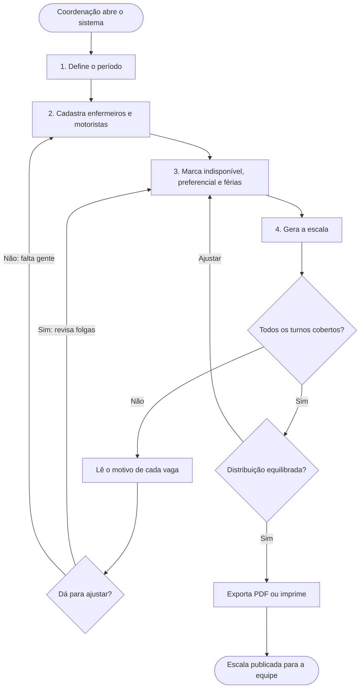
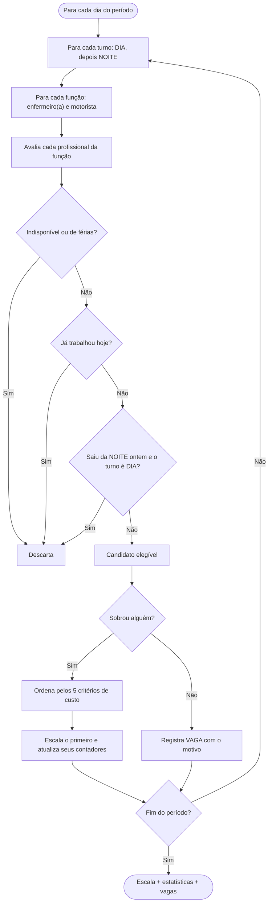
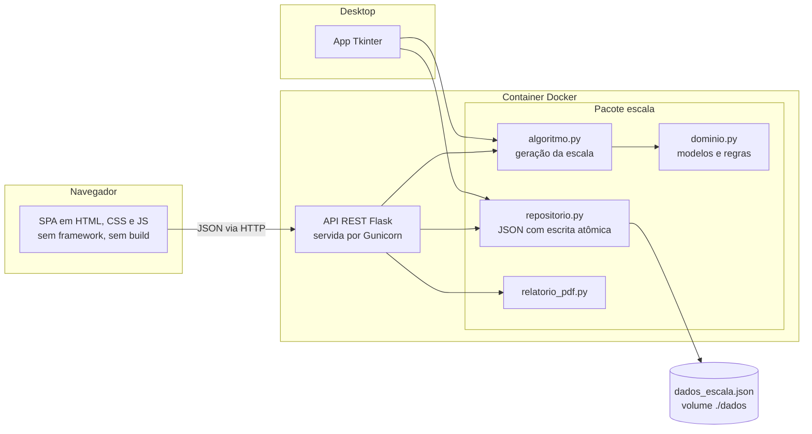

# Escala de Plantão · SAMU 192

> Estudo de caso · Carlos Alves Santos Jr · 2026
> Gerador automático de escalas para equipes de ambulância do SAMU: monta duplas de enfermeiro(a) e motorista para cada turno, respeita folgas, férias e descanso pós-noite, e divide os plantões de forma justa.

**Papel:** produto, backend, frontend e UX
**Stack:** Python 3.12 · Flask · Gunicorn · JavaScript (sem framework) · fpdf · Docker Compose · pytest · Tkinter


---

## 1. Contexto de uso

O SAMU 192 funciona 24 horas por dia. Em cada base, o dia é dividido em dois turnos, **DIA** e **NOITE**, e cada turno precisa de uma equipe completa na viatura: **um(a) enfermeiro(a) e um(a) motorista**. Num mês de 31 dias são 62 turnos e 124 posições a preencher.

Quem coordena a escala precisa encaixar a vida real da equipe nesse quadro: folgas pedidas, férias, outros vínculos de trabalho, preferências de turno. E precisa fazer isso sem deixar ninguém exausto, porque uma equipe cansada atende pior uma emergência.

### O problema

| Dor | O que acontece |
|---|---|
| Trabalho manual e lento | A escala é montada à mão em planilha ou papel, cruzando a disponibilidade de cada pessoa, turno a turno. |
| Turnos descobertos | Um encaixe errado no começo do mês só aparece dias depois, quando já não há quem cubra o turno. |
| Fadiga | Sem controle, alguém sai de um plantão noturno e entra no diurno seguinte. |
| Sensação de injustiça | Sem números, fica difícil mostrar que noites e fins de semana foram divididos por igual. |

### Regras inegociáveis

1. **Disponibilidade:** quem está indisponível ou de férias num turno nunca é escalado nele.
2. **Um plantão por dia:** ninguém trabalha DIA e NOITE na mesma data.
3. **Descanso pós-noite:** quem sai do turno da NOITE não entra no DIA seguinte.

---

## 2. A solução

Uma aplicação web em quatro etapas. A coordenação informa as restrições; o sistema cruza tudo e devolve a escala completa, com indicadores de cobertura e equilíbrio.

| Etapa | O que a coordenação faz |
|---|---|
| **1. Período** | Define o ciclo, com atalhos como "Próximo mês". |
| **2. Equipe** | Cadastra os profissionais por função. O painel avisa quando a equipe é pequena demais para garantir descanso. |
| **3. Disponibilidade** | Escolhe um "pincel" (Indisponível, Preferencial, Férias) e clica ou arrasta sobre os turnos. Clicar na data marca o dia inteiro; clicar em "Seg" marca todas as segundas. Salva sozinho. |
| **4. Escala** | Gera a escala com um clique. Vê cobertura, vagas (com o motivo) e equilíbrio por pessoa. Exporta em PDF. |


---

## 3. Fluxograma de uso



---

## 4. Como o algoritmo decide

O gerador percorre o período em ordem, turno a turno e função a função. Primeiro descarta quem não pode trabalhar; entre os que sobram, escolhe quem tem o menor "custo".



**Critérios de custo, em ordem de importância:**

1. **Olhar adiante:** evita escalar alguém que é o único disponível num turno logo à frente. Sem isso, o algoritmo guloso cria vagas que poderiam ser evitadas.
2. **Ninguém esquecido:** quem está há 7 dias sem plantão ganha prioridade, a não ser que tenha passado a semana toda de férias ou indisponível.
3. **Carga equilibrada:** vence quem tem menos plantões. O turno preferencial conta como um plantão a menos: a preferência pesa, mas não deixa uma pessoa ficar com todos os turnos.
4. **Noites e fins de semana:** entre empatados, escolhe quem fez menos noites e menos fins de semana.
5. **Desempate estável:** quem trabalhou há mais tempo e, por fim, a ordem alfabética. Os mesmos dados sempre geram a mesma escala.

---

## 5. Arquitetura

O projeto começou como um app desktop em Tkinter com tudo num arquivo só. A refatoração separou um **núcleo de domínio puro e testável**, usado tanto pela versão web quanto pela desktop.



| Caminho | Responsabilidade |
|---|---|
| `escala/dominio.py` | Modelos (`Funcionario`, `Periodo`, `Plantao`) e enums (`Cargo`, `Turno`, `Status`) |
| `escala/algoritmo.py` | Geração da escala, sem I/O |
| `escala/repositorio.py` | Persistência JSON com escrita atômica; lê o formato antigo |
| `escala/relatorio_pdf.py` | Exportação em PDF |
| `webapp.py` | API REST Flask e frontend em `static/` |
| `app.py` | Versão desktop, usando o mesmo núcleo |
| `tests/` | 21 testes de regras e da API |

### API

| Método | Rota | Função |
|---|---|---|
| `GET` | `/api/estado` | Período e equipe |
| `PUT` | `/api/periodo` | Define o período (até 92 dias) |
| `POST` / `PUT` / `DELETE` | `/api/funcionarios[/<id>]` | Cadastro da equipe |
| `PATCH` | `/api/funcionarios/<id>/disponibilidade` | Alterações de disponibilidade em lote |
| `POST` | `/api/escala` | Gera a escala com estatísticas e vagas |
| `GET` | `/api/escala.pdf` | Baixa o PDF |
| `GET` | `/saude` | Healthcheck do container |

---

## 6. Resultados

Comparação entre o algoritmo original e o novo, rodando sobre a disponibilidade real de uma equipe de 5 enfermeiros e 5 motoristas em outubro de 2026 (dados anonimizados):

| Métrica | Antes | Depois |
|---|---|---|
| Cobertura das 124 posições | 100% | 100% |
| Diferença máxima de plantões entre enfermeiros | 5 (14 × 9) | **3** (14 × 11) |
| Preferência de turno | Quem marcava tudo ficava com quase todos os plantões | Um plantão de vantagem, sem quebrar a equidade |
| Vagas evitáveis | Escolha gulosa, sem olhar o turno seguinte | Protege quem é o único disponível adiante |
| Noites e fins de semana | Não considerados | Entram no desempate |
| Vagas | "VAGO", sem explicação | Cada vaga informa o motivo |
| Identidade | Pela posição na lista; nomes repetidos permitidos | Identificador único; nome duplicado bloqueado |
| Dados | Gravação direta, podia corromper; período se perdia | Gravação atômica; período salvo |
| Uso | Só com Python instalado | Navegador, com instalação por Docker em um clique |

---

## 7. Decisões técnicas

- **Guloso com olhar adiante, em vez de um solver.** Programação inteira acharia o ótimo global, mas traz uma dependência pesada e é mais difícil de explicar. O guloso com critérios ordenados roda em milissegundos, é determinístico, e cada escolha pode ser explicada em uma frase.
- **Domínio puro e testável.** As regras não conhecem Flask, Tkinter nem JSON. Um dos testes falha de propósito se o "olhar adiante" for desligado.
- **Frontend sem build.** HTML, CSS e JavaScript puros, servidos pelo Flask. Não há Node nem bundler para manter.
- **JSON em vez de banco.** Para uma base com uma coordenação, um arquivo legível basta, é fácil de copiar como backup e é compatível com a versão anterior.
- **Container enxuto e seguro.** Imagem `python:3.12-slim` (cerca de 190 MB), usuário sem privilégios, healthcheck, porta exposta só para o próprio computador e dados num volume.
- **UX para quem usa.** Pincel com arrastar, atalhos de teclado de 1 a 4, aviso de escala desatualizada, layout que funciona no celular e a identidade visual do SAMU.

---

## 8. Como rodar

```bash
git clone https://github.com/CarlosAlvesSantosJr/escalas-de-plantao.git
cd escalas-de-plantao
docker compose up -d --build
# abra http://localhost:8080 — os dados ficam em ./dados
```

No Windows, basta um duplo clique em `iniciar.bat`. Veja o [guia de instalação](INSTALACAO.md).

## 9. Próximos passos

- Troca de plantão entre profissionais, com aprovação da coordenação.
- Ajuste manual de um turno direto na escala, com a validação das regras.
- Login e várias bases do SAMU no mesmo sistema.
- Envio da escala por WhatsApp ou e-mail.
