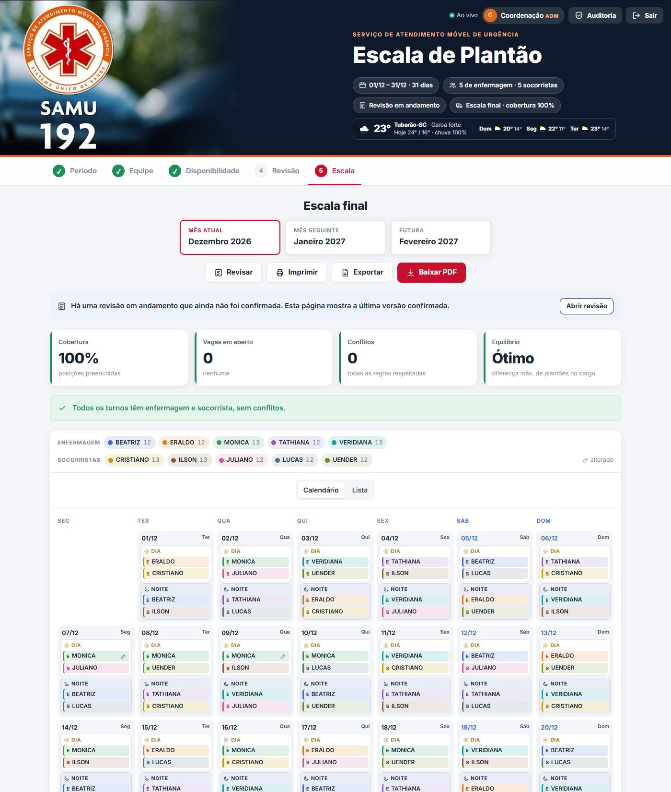
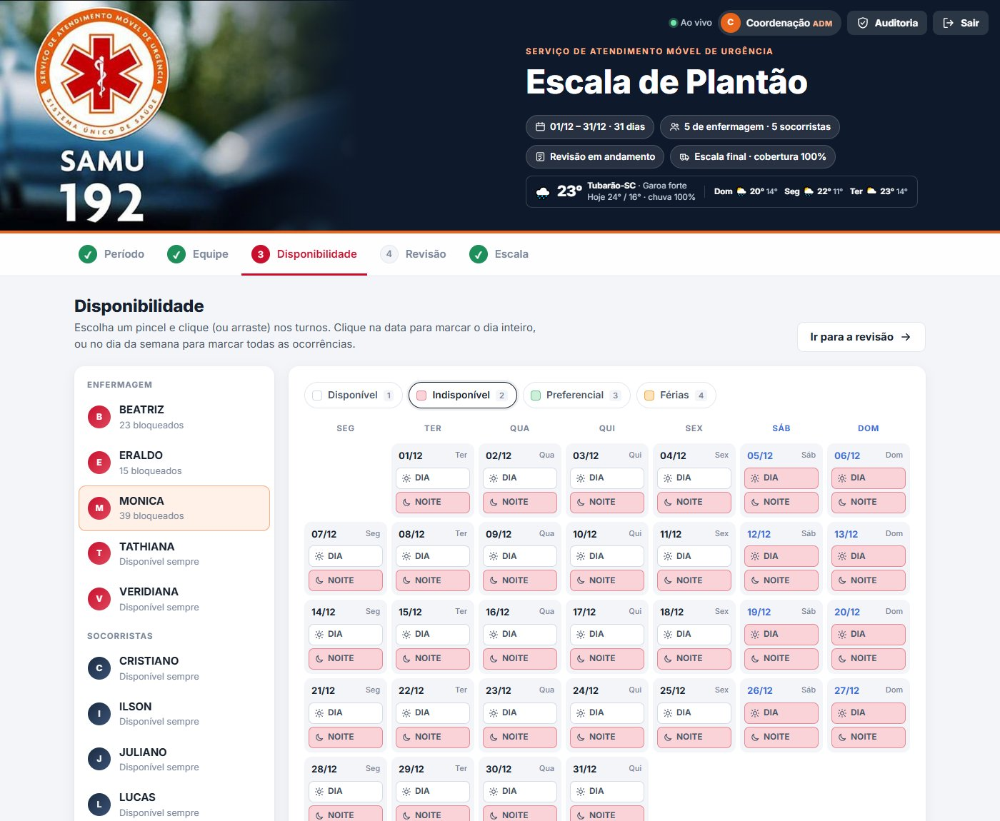
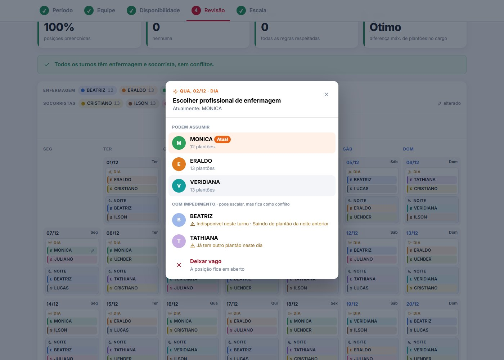
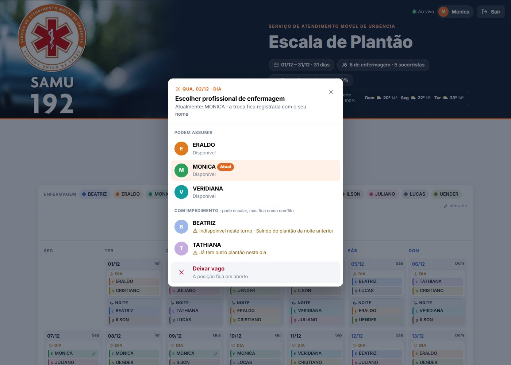
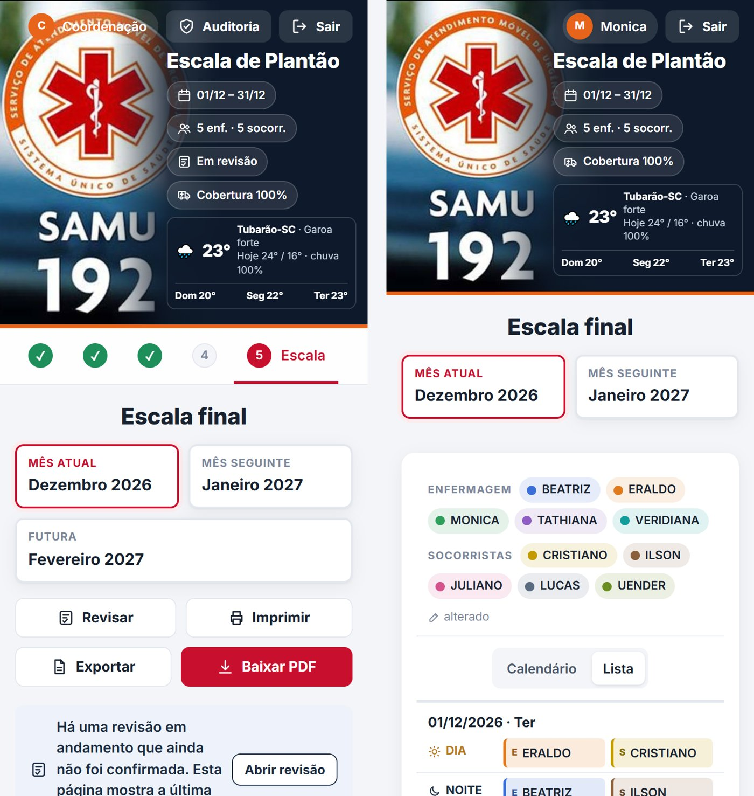
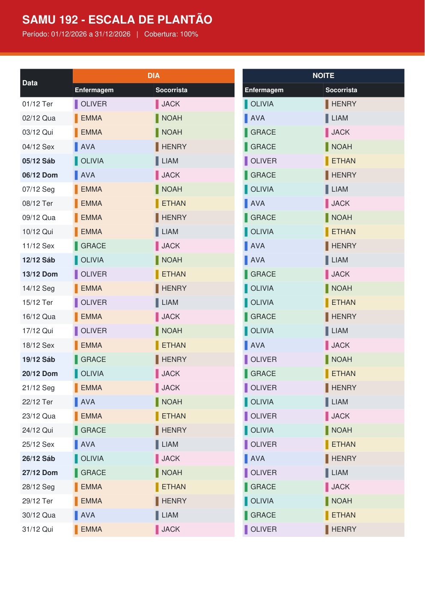
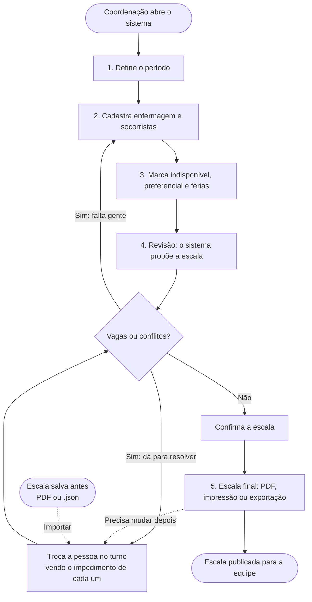
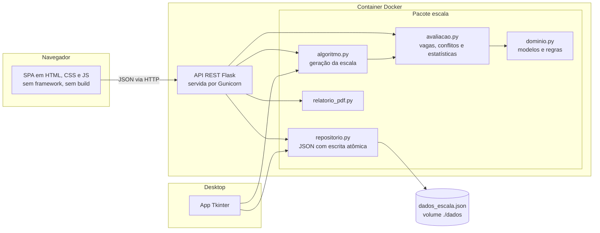

# Escala de Plantão · SAMU 192

> Estudo de caso · Carlos Alves Santos Jr · 2026
> Gerador automático de escalas para equipes de ambulância do SAMU: monta duplas de enfermagem e socorrista para cada turno, respeita folgas, férias e descanso pós-noite, e divide os plantões de forma justa. A coordenação revisa e ajusta a proposta antes de publicar.

**Papel:** produto, backend, frontend e UX
**Stack:** Python 3.12 · Flask · Gunicorn · JavaScript (sem framework) · PWA · fpdf · Docker · Kubernetes · pytest · Tkinter



---

## 1. Contexto de uso

O SAMU 192 funciona 24 horas por dia. Em cada base, o dia é dividido em dois turnos, **DIA** e **NOITE**, e cada turno precisa de uma equipe completa na viatura: **um(a) profissional de enfermagem e um(a) socorrista**. Num mês de 31 dias são 62 turnos e 124 posições a preencher.

Quem coordena a escala precisa encaixar a vida real da equipe nesse quadro: folgas pedidas, férias, outros vínculos de trabalho, preferências de turno. E precisa fazer isso sem deixar ninguém exausto, porque uma equipe cansada atende pior uma emergência.

### O problema

| Dor | O que acontece |
|---|---|
| Trabalho manual e lento | A escala é montada à mão em planilha ou papel, cruzando a disponibilidade de cada pessoa, turno a turno. |
| Turnos descobertos | Um encaixe errado no começo do mês só aparece dias depois, quando já não há quem cubra o turno. |
| Fadiga | Sem controle, alguém sai de um plantão noturno e entra no diurno seguinte. |
| Sensação de injustiça | Sem números, fica difícil mostrar que noites e fins de semana foram divididos por igual. |

### Regras inegociáveis

1. **Disponibilidade:** quem está indisponível ou de férias num turno nunca é escalado nele.
2. **Um plantão por dia:** ninguém trabalha DIA e NOITE na mesma data.
3. **Descanso pós-noite:** quem sai do turno da NOITE não entra no DIA seguinte.

---

## 2. A solução

Uma aplicação web em cinco etapas. A coordenação informa as restrições; o sistema cruza tudo e propõe a escala completa. A coordenação revisa, ajusta o que for preciso e só então publica.

| Etapa | O que a coordenação faz |
|---|---|
| **1. Período** | Define o ciclo, com atalhos como "Próximo mês". |
| **2. Equipe** | Cadastra os profissionais por função. O painel avisa quando a equipe é pequena demais para garantir descanso. |
| **3. Disponibilidade** | Escolhe um "pincel" (Indisponível, Preferencial, Férias) e clica ou arrasta sobre os turnos. Clicar na data marca o dia inteiro; clicar em "Seg" marca todas as segundas. Salva sozinho. |
| **4. Revisão** | Recebe a proposta automática e ajusta à mão: clica num nome, vê quem está livre e por que os outros não estão, troca ou deixa vago. Cada ajuste é checado contra as regras na hora, e dá para desfazer. |
| **5. Escala** | Confirma a versão final. Cada profissional ganha uma cor, e a legenda destaca os plantões de cada um. Baixa o PDF, imprime ou exporta (só a coordenação). A escala pode ser reaberta para edição ou importada em outro computador. |



### Revisão manual

O algoritmo não conhece tudo: uma troca combinada no corredor, alguém que vai cobrir um colega. Por isso a escala gerada é uma **proposta**. Na revisão, clicar num nome abre a lista de quem pode assumir aquele turno, com o número de plantões de cada um, e de quem tem impedimento, com o motivo escrito ("De férias", "Já tem outro plantão neste dia", "Saindo do plantão da noite anterior").

A coordenação pode escalar alguém com impedimento quando a exceção foi combinada. O sistema não bloqueia, mas registra a posição como **conflito**, que aparece nos indicadores e precisa ser confirmada de propósito.



### A equipe troca plantões, com as regras de descanso checadas na hora

Depois de publicada, a escala fica com a equipe. Cada profissional entra com nome e matrícula, no celular, e pode trocar quem está num plantão. O editor é o mesmo da revisão: **"Podem assumir"** de um lado e **"Com impedimento"** do outro, com o motivo escrito. Quem saiu da NOITE anterior aparece como "Saindo do plantão da noite anterior"; quem já tem plantão no dia, como "Já tem outro plantão neste dia"; quem pegaria a NOITE tendo o DIA de amanhã, como "Tem plantão de dia logo após esta noite".

A troca não espera aprovação, mas também não acontece no escuro: o servidor recusa se outra pessoa trocou a mesma posição antes, a mudança aparece em todas as telas em até 3 segundos e fica na auditoria da coordenação. O usuário não vê números de ninguém; a coordenação vê o total de plantões de cada pessoa, os conflitos e a distribuição.

<table><tr>
<td></td>
<td></td>
</tr><tr>
<td align="center"><sub>Troca de plantão: quem pode assumir e quem tem impedimento</sub></td>
<td align="center"><sub>Celular: coordenação (ADM) × equipe (Usuário)</sub></td>
</tr></table>

### Mês atual e mês seguinte

A equipe vê sempre duas escalas, em abas. O par só avança quando o mês vira **e** a coordenação confirma a escala nova: com Dezembro e Janeiro publicados, Dezembro segue como "Mês atual" até que, já em janeiro, Fevereiro seja confirmado.

### O PDF para a equipe

Uma página por mês, com uma linha por dia: **DIA** à esquerda e **NOITE** à direita, cada um com **Enfermagem** e **Socorrista**. Cada pessoa tem a mesma cor da tela, para achar os próprios plantões de relance. O resumo de plantões por profissional fica só no sistema.

O PDF também carrega os dados da escala embutidos. Assim, o mesmo arquivo que vai para o grupo da equipe serve para **importar** a escala de volta e editá-la, inclusive em outro computador.



---

## 3. Fluxograma de uso



---

## 4. Como o algoritmo decide

O gerador percorre o período em ordem, turno a turno e função a função. Primeiro descarta quem não pode trabalhar; entre os que sobram, escolhe quem tem o menor "custo".


**Critérios de custo, em ordem de importância:**

1. **Olhar adiante:** evita escalar alguém que é o único disponível num turno logo à frente. Sem isso, o algoritmo guloso cria vagas que poderiam ser evitadas.
2. **Ninguém esquecido:** quem está há 7 dias sem plantão ganha prioridade, a não ser que tenha passado a semana toda de férias ou indisponível.
3. **Carga equilibrada:** vence quem tem menos plantões. O turno preferencial conta como um plantão a menos: a preferência pesa, mas não deixa uma pessoa ficar com todos os turnos.
4. **Noites e fins de semana:** entre empatados, escolhe quem fez menos noites e menos fins de semana.
5. **Desempate estável:** quem trabalhou há mais tempo e, por fim, a ordem alfabética. Os mesmos dados sempre geram a mesma escala.

---

## 5. Arquitetura

O projeto começou como um app desktop em Tkinter com tudo num arquivo só. A refatoração separou um **núcleo de domínio puro e testável**, usado tanto pela versão web quanto pela desktop.



| Caminho | Responsabilidade |
|---|---|
| `escala/dominio.py` | Modelos (`Funcionario`, `Periodo`, `Plantao`, `Escala`) e enums (`Cargo`, `Turno`, `Status`) |
| `escala/algoritmo.py` | Geração da escala, sem I/O |
| `escala/avaliacao.py` | Vagas, conflitos, estatísticas e candidatos de qualquer escala, gerada ou editada |
| `escala/repositorio.py` | Persistência JSON com escrita atômica: equipe, rascunho em revisão e escala final; lê o formato antigo |
| `escala/relatorio_pdf.py` | PDF com DIA e NOITE lado a lado, com os dados embutidos para reimportar |
| `webapp.py` | API REST Flask e frontend em `static/` |
| `app.py` | Versão desktop, usando o mesmo núcleo |
| `tests/` | 48 testes de regras, da API, dos perfis, do mês atual/seguinte, da auditoria e do PWA |

### API e documentação técnica

A API REST tem cerca de 25 rotas, e cada uma diz que perfil pode usá-la (as da equipe são só: ver a escala, ver candidatos e trocar um plantão). A referência completa, com **UML de classes, diagramas de sequência do login e da troca de plantão, ciclo de vida da escala e matriz de permissões**, está em [ARQUITETURA.md](ARQUITETURA.md).

---|---|---|
| `GET` | `/api/estado` | Período, equipe, rascunho e escala final |
| `PUT` | `/api/periodo` | Define o período (até 92 dias) |
| `POST` / `PUT` / `DELETE` | `/api/funcionarios[/<id>]` | Cadastro da equipe |
| `PATCH` | `/api/funcionarios/<id>/disponibilidade` | Alterações de disponibilidade em lote |
| `GET` / `POST` / `DELETE` | `/api/rascunho` | Consulta, gera ou descarta a escala em revisão |
| `PATCH` | `/api/rascunho` | Ajusta posições em lote (`funcionario_id: null` = vago) |
| `GET` | `/api/rascunho/candidatos` | Quem pode ocupar uma posição e o que cada um quebraria |
| `GET` / `POST` | `/api/escala` | Consulta a escala final / confirma o rascunho |
| `POST` | `/api/escala/editar` | Reabre a escala final para revisão |
| `POST` | `/api/escala/importar` | Importa um `.json` exportado ou um PDF gerado pelo sistema |
| `GET` | `/api/escala.pdf` · `/api/escala.json` | Baixa a escala final |
| `GET` | `/saude` | Healthcheck do container |

---

## 6. Resultados

Comparação entre o algoritmo original e o novo, rodando sobre a disponibilidade real de uma equipe de 5 profissionais de enfermagem e 5 socorristas em outubro de 2026 (dados anonimizados):

| Métrica | Antes | Depois |
|---|---|---|
| Cobertura das 124 posições | 100% | 100% |
| Diferença máxima de plantões na enfermagem | 5 (14 × 9) | **3** (14 × 11) |
| Preferência de turno | Quem marcava tudo ficava com quase todos os plantões | Um plantão de vantagem, sem quebrar a equidade |
| Vagas evitáveis | Escolha gulosa, sem olhar o turno seguinte | Protege quem é o único disponível adiante |
| Noites e fins de semana | Não considerados | Entram no desempate |
| Vagas | "VAGO", sem explicação | Cada vaga informa o motivo |
| Identidade | Pela posição na lista; nomes repetidos permitidos | Identificador único; nome duplicado bloqueado |
| Dados | Gravação direta, podia corromper; período se perdia | Gravação atômica; período salvo |
| Uso | Só com Python instalado | Navegador, com instalação por Docker em um clique |
| Ajuste manual | Editar a planilha depois, sem checar as regras | Revisão na própria escala, com conflitos apontados na hora e desfazer |
| Leitura da escala | Tabela única, uma linha por turno | Cores por profissional; PDF de uma página com DIA e NOITE lado a lado |
| Reaproveitamento | A escala só existia no papel ou no PDF | O PDF reimporta a escala para edição, inclusive em outro computador |

---

## 7. Decisões técnicas

- **Guloso com olhar adiante, em vez de um solver.** Programação inteira acharia o ótimo global, mas traz uma dependência pesada e é mais difícil de explicar. O guloso com critérios ordenados roda em milissegundos, é determinístico, e cada escolha pode ser explicada em uma frase.
- **Domínio puro e testável.** As regras não conhecem Flask, Tkinter nem JSON. Um dos testes falha de propósito se o "olhar adiante" for desligado.
- **Frontend sem build.** HTML, CSS e JavaScript puros, servidos pelo Flask. Não há Node nem bundler para manter.
- **JSON em vez de banco.** Para uma base com uma coordenação, um arquivo legível basta, é fácil de copiar como backup e é compatível com a versão anterior.
- **Container enxuto e seguro.** Imagem `python:3.12-slim` (cerca de 190 MB), usuário sem privilégios, healthcheck, porta exposta só para o próprio computador e dados num volume.
- **UX para quem usa.** Pincel com arrastar, atalhos de teclado de 1 a 4, a identidade visual do SAMU e um layout pensado para o celular: escala em cartões por dia, símbolo do SAMU sempre visível no topo, previsão do tempo de Tubarão-SC e instalação como app (PWA).
- **Auditoria com prazo.** Os eventos ficam 30 dias e depois são apagados automaticamente, numa reescrita atômica do arquivo; o prazo é configurável.
- **Proposta, não imposição.** O algoritmo sugere; a coordenação decide. A revisão avisa, mas não bloqueia: uma exceção combinada com a equipe vira um conflito visível em vez de um obstáculo.
- **Uma única fonte de regras.** A mesma avaliação (`avaliacao.py`) mede a escala gerada e a editada à mão. Não existe uma regra no algoritmo e outra na tela.
- **Rascunho separado da escala final.** Editar não mexe na versão publicada até a confirmação, e dá para descartar a edição.
- **O PDF é o arquivo de troca.** Os dados vão embutidos no PDF que a equipe já recebe. A coordenação não precisa guardar um segundo arquivo para reabrir a escala depois.
- **Cor como apoio, não como único sinal.** Cada profissional tem uma cor, mas o nome e a função estão sempre escritos, com texto escuro sobre fundo claro. Quem não distingue cores lê a escala do mesmo jeito.
- **Privacidade da equipe.** O resumo de plantões por pessoa serve à coordenação e fica fora do PDF e da impressão. O servidor nem envia ao perfil Usuário os indicadores, os conflitos, a disponibilidade dos colegas e o total de plantões de cada um.
- **Permissão no servidor, não só na tela.** Esconder um botão não basta: as rotas da coordenação respondem 403 ao perfil Usuário, e cada resposta é filtrada pelo perfil.
- **Concorrência sem banco.** Cada troca leva quem o cliente viu na posição; se mudou, o servidor recusa (409) em vez de sobrescrever. As telas consultam uma rota leve de versão a cada 3 segundos.

---

## 8. Como rodar

```bash
git clone https://github.com/CarlosAlvesSantosJr/escalas-de-plantao.git
cd escalas-de-plantao
docker compose up -d --build
# abra http://localhost:8080 — os dados ficam em ./dados
```

No Windows, basta um duplo clique em `iniciar.bat`. Veja o [guia de instalação](INSTALACAO.md).

## 9. Próximos passos

- Aprovação opcional da coordenação para trocas feitas pela equipe.
- Várias bases do SAMU no mesmo sistema.
- Endereço fixo (túnel nomeado ou domínio próprio) para o app instalado.
- Envio da escala por WhatsApp ou e-mail.
